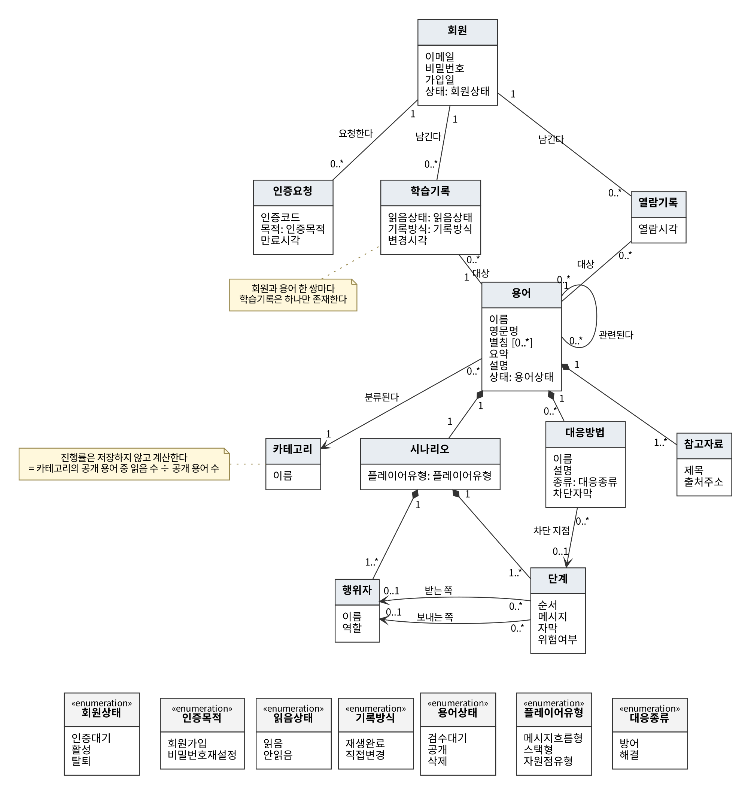

# 도메인 모델

설계 결정(ID, 타입, 메서드, 저장 방식)을 넣지 않은 개념 수준의 모델이다. 구현 시 저장 구조는 `03-architecture.md`의 DynamoDB 설계를, 용어 데이터 형식은 `04-content-format.md`를 따른다.

## 클래스

| 클래스 | 의미 | 구현 위치 |
| --- | --- | --- |
| 회원 | 이메일로 가입해 학습 기록을 남기는 사용자. 상태: 인증대기·활성·탈퇴 | Cognito User Pool |
| 인증요청 | 회원가입·비밀번호 재설정 때 이메일로 보내는 인증 코드 | Cognito가 처리 |
| 학습기록 | 회원이 특정 용어를 읽었는지(읽음·안 읽음)와 기록 방식(재생 완료·직접 변경) | DynamoDB `LearningRecord` |
| 열람기록 | 회원이 용어를 연 시각. 최근 본 용어 목록용 | DynamoDB `RecentView` (TTL) |
| 용어 | 사전 항목. 상태: 검수대기·공개·삭제 | `content/terms/<id>.json` (`status`: draft·published·retired) |
| 카테고리 | 웹 보안, 네트워크, 운영체제, 자료구조·런타임 | JSON의 `category` 값 |
| 시나리오 | 애니메이션의 대본. 플레이어 유형을 가진다 | JSON의 `scenario` |
| 행위자 | 애니메이션 등장인물 (사용자, 공격자, 서버, 함수, 프로세스, 자원 등) | `scenario.actors` |
| 단계 | 애니메이션의 한 장면. 동작, 보내는 쪽, 받는 쪽, 메시지, 자막, 위험 여부 | `scenario.steps` |
| 대응방법 | 보안 용어의 방어 기법 또는 CS 용어의 해결 방법. 막는 단계를 가리킬 수 있다 | JSON의 `defenses` |
| 참고자료 | 내용의 근거가 된 출처 | JSON의 `references` |

## 지켜야 할 규칙

- 회원과 용어 한 쌍마다 학습기록은 하나만 있다. (`LearningRecord`의 키가 userId + termId이므로 저장 구조로 보장된다)
- 진행률은 저장하지 않고 계산한다: 카테고리의 공개 용어 중 읽음 수 ÷ 공개 용어 수.
- 용어를 지우면 그 용어의 시나리오, 대응방법, 참고자료도 함께 사라진다(합성). 단, 학습 기록과의 연결 때문에 용어 파일은 `retired`로 남기고 ID는 재사용하지 않는다.
- 회원이 탈퇴하면 그 회원의 학습기록과 열람기록을 모두 삭제한다.

## 다이어그램 이후 바뀐 점

- **단계에 `동작`(action) 속성이 추가됐다.** 값은 `send`, `push`, `pop`, `acquire`, `wait`, `release`이다. 흐름형뿐 아니라 스택형·점유형도 같은 형식으로 표현하기 위해서다.
- 그에 따라 단계의 보내는 쪽·받는 쪽은 다이어그램의 `0..1`이 아니라 **항상 1**이다. 함수 호출은 호출한 함수 → 호출된 함수, 자원 요청은 프로세스 → 자원으로 표현한다.
