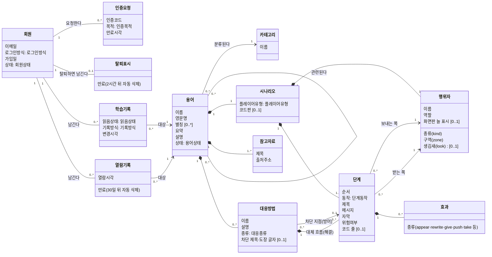

# 도메인 모델

설계 결정(ID, 타입, 메서드, 저장 방식)을 넣지 않은 개념 수준의 모델이다. 구현 시 저장 구조는 `03-architecture.md`의 DynamoDB 설계를, 용어 데이터 형식은 `04-content-format.md`를 따른다.

## 도메인 모델(현재 기준, 2026-11-21)

| 열거형 | 값 |
| --- | --- |
| 회원상태 | 인증대기 · 활성 · 탈퇴 |
| 로그인방식 | 이메일 · Google(같은 이메일이어도 서로 다른 회원) |
| 인증목적 | 회원가입 · 비밀번호재설정 |
| 읽음상태 / 기록방식 | 읽음 · 안읽음 / 재생완료 · 직접변경 |
| 용어상태 | 검수대기(draft) · 공개(published) · 삭제(retired) |
| 플레이어유형 | 메시지흐름형(flow) · 스택형(stack) · 자원점유형(lock) |
| 단계동작 | send · push · pop · run · acquire · wait · release |
| 대응종류 | 방어(차단 지점에서 멈춤) · 해결(분기 단계부터 대체 흐름) · 보조(차단 없음, 설명만) |

## 예전 제출본과 달라진 점

예전 제출본 그림(첫 커밋 `a31fb77`):

| 예전 제출본 | 현재 | 변경 ID(docs/07) |
| --- | --- | --- |
| 회원 속성: 이메일·비밀번호·가입일·상태 | 로그인방식(이메일·Google) 추가. Google 회원은 비밀번호가 없고, 비밀번호는 원래부터 Cognito가 보관 | CH-35 |
| (없음) | 탈퇴표시: 탈퇴 직후 예전 토큰으로 기록이 다시 생기지 않게 2시간 남김 | CH-27, CH-39 |
| 행위자: 이름·역할 | 종류·구역(3D 자동 배치), 생김새(look), 화면판 늘 표시(mirrorScreen) | CH-08·CH-09, CH-17, CH-22 |
| 단계: 순서·메시지·자막·위험여부, 보내는 쪽·받는 쪽 0..1 | 동작·제목·코드 줄·효과 추가, 보내는 쪽·받는 쪽은 항상 1 | CH-07, CH-09, CH-21(아래 "다이어그램 이후 바뀐 점") |
| (없음) | 효과: 단계 안에서 일어나는 일(쿠키 저장·화면 글자 바뀜·자원 잡기 등)의 일반 어휘 | CH-09, CH-11 |
| 대응방법: 차단 지점 0..1 | 종류가 방어·해결·보조. 해결은 분기 단계부터 대체 흐름(단계 1..*)을 가진다 | CH-12, CH-21 |
| 시나리오: 플레이어유형 | 스택형의 코드판(의사코드 줄) 추가 | 기능 추가(4단계 `df04a73`), 변경 아님 |
| 열람기록: 열람시각 | 30일 뒤 자동 삭제(TTL)를 명시 | 7단계 결정(`e10794d`), 변경 아님 |

## 클래스

| 클래스 | 의미 | 구현 위치 |
| --- | --- | --- |
| 회원 | 이메일로 가입해 학습 기록을 남기는 사용자. 상태: 인증대기·활성·탈퇴 | Cognito User Pool |
| 인증요청 | 회원가입·비밀번호 재설정 때 이메일로 보내는 인증 코드 | Cognito가 처리 |
| 학습기록 | 회원이 특정 용어를 읽었는지(읽음·안 읽음)와 기록 방식(재생 완료·직접 변경) | DynamoDB `LearningRecord` |
| 열람기록 | 회원이 용어를 연 시각. 최근 본 용어 목록용 | DynamoDB `RecentView` (TTL) |
| 용어 | 사전 항목. 상태: 검수대기·공개·삭제 | `content/terms/<id>.json` (`status`: draft·published·retired) |
| 카테고리 | 웹 보안, 네트워크, 운영체제, 자료구조·런타임 | JSON의 `category` 값 |
| 시나리오 | 애니메이션의 대본. 플레이어 유형을 가진다 | JSON의 `scenario` |
| 행위자 | 애니메이션 등장인물 (사용자, 공격자, 서버, 함수, 프로세스, 자원 등) | `scenario.actors` |
| 단계 | 애니메이션의 한 장면. 동작, 보내는 쪽, 받는 쪽, 메시지, 자막, 위험 여부 | `scenario.steps` |
| 대응방법 | 보안 용어의 방어 기법 또는 CS 용어의 해결 방법. 막는 단계를 가리킬 수 있다 | JSON의 `defenses` |
| 참고자료 | 내용의 근거가 된 출처 | JSON의 `references` |

## 지켜야 할 규칙

- 회원과 용어 한 쌍마다 학습기록은 하나만 있다. (`LearningRecord`의 키가 userId + termId이므로 저장 구조로 보장된다) 안 읽음으로 되돌려도 기록을 지우지 않고 `read:false`(기록 방식: 직접 변경)로 남긴다.
- 진행률은 저장하지 않고 계산한다: 카테고리의 공개 용어 중 읽음 수 ÷ 공개 용어 수.
- 용어를 지우면 그 용어의 시나리오, 대응방법, 참고자료도 함께 사라진다(합성). 단, 학습 기록과의 연결 때문에 용어 파일은 `retired`로 남기고 ID는 재사용하지 않는다.
- 회원이 탈퇴하면 그 회원의 학습기록과 열람기록을 모두 삭제한다. 탈퇴 직후 아직 유효한 토큰으로 기록이 다시 생기지 않도록, 같은 테이블에 "탈퇴함" 표시(2시간 뒤 자동 삭제)를 잠시 남긴다(`03-architecture.md` 2.5).

## 다이어그램 이후 바뀐 점

- **단계에 `동작`(action) 속성이 추가됐다.** 값은 `send`, `push`, `pop`, `acquire`, `wait`, `release`이다. 흐름형뿐 아니라 스택형·점유형도 같은 형식으로 표현하기 위해서다.
- 그에 따라 단계의 보내는 쪽·받는 쪽은 다이어그램의 `0..1`이 아니라 **항상 1**이다. 함수 호출은 호출한 함수 → 호출된 함수, 자원 요청은 프로세스 → 자원으로 표현한다.
