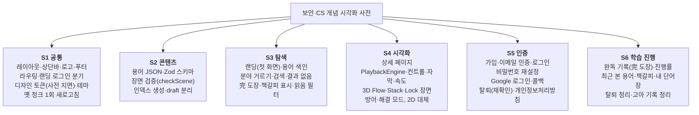
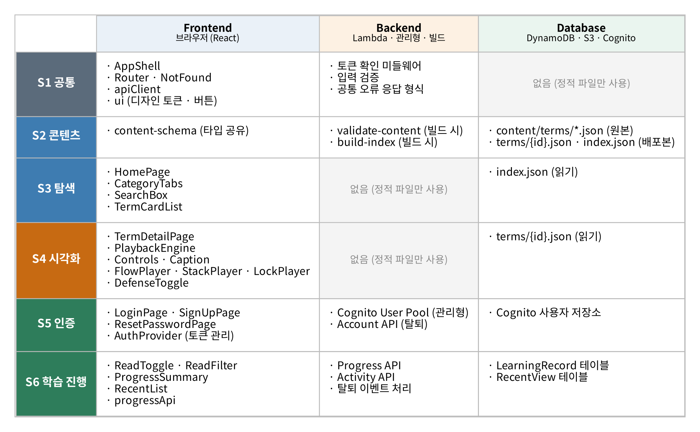
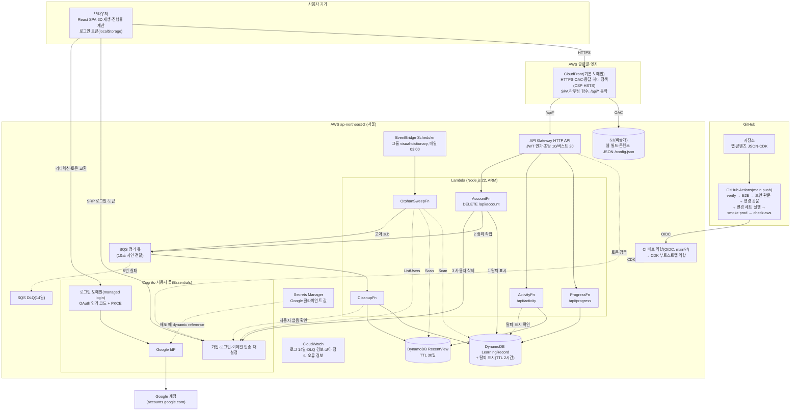

# 아키텍처

서브시스템 구성, 계층 구조, 기술 스택, AWS 배치를 정리한 문서다. 구현 단계는 1.4절과 루트의 `CLAUDE.md`에 같은 내용이 있다.

## 1. 모듈뷰 아키텍처

### 1.1 서브시스템 분해 (Decomposition Style)

요구사항 명세의 서브시스템(SS-01~SS-07)을 출발점으로, 실제로 코드가 나뉘는 단위에 맞게 6개 서브시스템으로 다시 정리했다.

예전 제출본 그림은 1.6절에 있다.

| 서브시스템 | 책임 | 관련 요구사항 |
| --- | --- | --- |
| S1 공통 | 모든 화면이 함께 쓰는 레이아웃·로고, 라우팅(랜딩 로그인 분기 포함), 오류 페이지, API 호출 방식 | FR-EXP-05, FR-EXP-07, FR-DTL-04, FR-AUTH-04 |
| S2 콘텐츠 | 용어 데이터 파일의 형식 정의와 검증, 목록·검색용 인덱스 생성 | SS-06 (FR-CNT-01~05) |
| S3 탐색 | 첫 화면(랜딩), 용어 색인, 카테고리 필터, 키워드 검색 | SS-01 |
| S4 시각화 | 용어 상세 페이지와 애니메이션 플레이어, 재생 제어, 방어 모드 | SS-02, SS-03 |
| S5 인증 | 회원가입, 로그인, 비밀번호 재설정, 회원 탈퇴 | SS-04 |
| S6 학습 진행 | 완독 기록(完 도장), 진행률, 읽음 상태 필터, 최근 본 용어, 책갈피 | SS-05 |

요구사항과 달라진 점은 세 가지다. 용어 상세 조회(SS-02)와 애니메이션 재생(SS-03)은 한 화면에서 같은 데이터를 쓰며 함께 동작하므로 S4 하나로 합쳤다. 여러 서브시스템이 함께 쓰는 화면 틀과 API 호출 코드는 S1 공통으로 따로 뺐다. 배포·운영(SS-07)은 코드 모듈이 아니라 실행 환경에 관한 내용이므로 모듈뷰에서 빼고 2장의 할당뷰에서 다룬다.

### 1.2 계층별 상세화 (Frontend / Backend / Database)

각 서브시스템을 Frontend, Backend, Database 계층으로 나누면 다음과 같다.

| | Frontend(브라우저, React) | Backend(Lambda·관리형·빌드) | Database(DynamoDB·S3·Cognito) |
| --- | --- | --- | --- |
| S1 공통 | `Layout`·`Logo`·`main.tsx` 라우터(랜딩 분기 `hasStoredSession`)·`NotFoundPage`·`useJson`·디자인 토큰 | API Gateway JWT 인가(토큰 확인), 핸들러별 입력 검증·공통 응답 형식 | 없음(정적 파일만) |
| S2 콘텐츠 | `content-schema`(스키마·타입 공유) | `validate-content`·`build-index`(빌드 시) | `content/terms/*.json`(원본), `/content/index.json`·`/content/terms/{id}.json`(배포본, S3) |
| S3 탐색 | `LandingPage`(`DictionaryPage`·`SketchFigure`), `HomePage`(용어 색인: 분야·검색·읽음 필터), 사전 지면 부품(`features/dictionary/`) | 없음(손글씨 글꼴 조각은 빌드 때 생성) | `index.json` 읽기 |
| S4 시각화 | `TermPage`, `Explanation`·`Footnotes`(설명 틀), `PlaybackEngine`(`engine.ts`), `PlayerShell`, `FlowScene`·`StackScene`·`LockScene`, `StepList2D` | 없음 | `terms/{id}.json` 읽기 |
| S5 인증 | `LoginPage`·`SignupPage`·`ConfirmPage`·`ResetPage`·`CallbackPage`, 인증 저장소(`auth/store.ts`), `PrivacyPage` | Cognito 사용자 풀(Essentials, 로그인 도메인, Google IdP), Account API(탈퇴, 재인증 5분) | Cognito 사용자 저장소, Secrets Manager(Google 클라이언트) |
| S6 학습 진행 | `StudyMark`(제목 줄 큰 完 도장·플레이어 아래 알림, 애니메이션 끝에서 자동 기록)·`Ledger`(진행률)·`MePage`, 책갈피 규칙(`bookmarks.ts`), 기록 저장소(`useSyncExternalStore`) | Progress API·Activity API, 정리 Lambda(SQS), 고아 정리 Lambda(Scheduler) | `LearningRecord`(탈퇴 표시 포함)·`RecentView`(TTL 30일) |

예전 제출본 그림은 1.6절에 있다.

이 표에서 가장 중요한 특징은 **탐색(S3)과 시각화(S4)에 백엔드가 없다**는 점이다. 용어 콘텐츠는 운영 중에 바뀌지 않고 배포할 때만 바뀌므로, S2가 빌드 시점에 데이터 파일을 검증해 `/content/index.json`(목록·검색용)과 `/content/terms/{id}.json`(용어별 상세·시나리오)으로 만들어 두고, 브라우저는 이 정적 파일만 읽는다. 그래서 학습 기록 API가 멈춰도 용어 조회와 애니메이션 재생은 그대로 동작한다(NFR-02).

백엔드가 필요한 곳은 사용자마다 데이터가 달라지는 S5와 S6뿐이다. 회원가입·로그인·이메일 인증·비밀번호 재설정은 Cognito가 제공하는 기능을 그대로 쓰고, 직접 만드는 API는 회원 탈퇴(Account API)와 학습 기록(Progress API, Activity API)이다. 진행률은 클래스 다이어그램에서 정한 대로 저장하지 않고, 브라우저가 `index.json`의 카테고리별 공개 용어 수와 학습 기록을 합쳐 계산한다.

### 1.3 서브시스템 간 의존 관계

| 사용하는 쪽 | 사용되는 쪽 | 내용 |
| --- | --- | --- |
| S3 탐색, S4 시각화 | S2 콘텐츠 | 빌드된 `/content/index.json`, `/content/terms/{id}.json`을 읽는다 |
| S3 탐색 | S6 학습 진행 | 로그인 시 용어 줄의 完 도장·책갈피, 읽음 필터, 진행률을 보여준다 |
| S4 시각화 | S6 학습 진행 | 마지막 단계에 순서대로(재생·다음) 도착하면 `onComplete`로 완독 기록을 저장한다(단계 막대 건너뛰기는 제외, 취소한 용어는 자동 재기록 없음) |
| S6 학습 진행 | S5 인증 | 로그인 토큰으로 본인 기록만 조회·수정한다 |
| 모든 서브시스템 | S1 공통 | 화면 틀, 라우팅, API 클라이언트 |

S3, S4가 S6을 사용하는 부분은 로그인한 경우에만 동작하는 선택적 의존이다. S6이 없어도 S3, S4는 비회원 기능으로 완전히 동작하므로, 이 의존 방향이 다음 절의 구현 순서를 정하는 근거가 된다.

이전 MSA 과제에서 나눈 서비스와는 다음과 같이 대응된다. User는 S5, Progress와 Activity는 S6의 두 API로 이어진다. Content와 Authoring은 운영 중 서버로 두지 않고 S2의 빌드 파이프라인과 정적 파일로 대신했는데, 용어 콘텐츠는 배포할 때만 바뀌므로 운영 중 서버가 필요 없고, 요구사항의 "데이터 파일로 추가하고 빌드 때 검증"(FR-CNT, DC-03), "상시 서버 없음"(DC-02) 조건에도 맞기 때문이다.

### 1.4 서브시스템별 구현 우선순위

서비스의 핵심 가치는 시각화이므로, 백엔드 없이 동작하는 S2·S4·S3을 먼저 완성하고 인증과 학습 진행을 나중에 붙인다. 각 단계는 끝났을 때 배포된 주소에서 직접 확인할 수 있는 상태를 기준으로 나눴다.

| 단계 | 서브시스템 | 구현 범위 | 완료 기준 |
| --- | --- | --- | --- |
| 1 | S1 공통, S2 콘텐츠 | 프로젝트 생성, 화면 틀, 시나리오 스키마와 검증기, CSRF 데이터 1개, CDK로 S3·CloudFront 최초 배포 | 배포 주소에 빈 화면이 뜨고, 형식이 틀린 데이터는 빌드에서 거부된다 |
| 2 | S4 시각화 (흐름형) | 재생 엔진, 장면 스키마, 3D 흐름형 플레이어, 컨트롤·자막, 방어 모드, 2D 대체 화면 | CSRF가 3D로 끝까지 재생되고, 방어 모드에서 5단계에서 차단된다 |
| 3 | S3 탐색, S2 확장 | 목록, 카테고리 필터, 검색, 보안 용어 4개 데이터 추가 | 플레이어 코드를 고치지 않고 데이터만 추가해 새 용어가 재생된다 |
| 4 | S4 확장 | 3D 스택형·점유형 플레이어, CS 용어 3개 | 초기 용어 8개가 모두 재생된다. 여기까지 비회원 기능 완성 |
| 5 | S5 인증 | Cognito 설정, 회원가입·이메일 인증·로그인·비밀번호 재설정 화면 | 가입부터 로그인까지 되고, 새로고침해도 로그인이 유지된다 |
| 6 | S6 학습 진행, S5 탈퇴 | Progress API, 읽음 기록·진행률·필터, Account API와 탈퇴 시 기록 삭제 | 다른 브라우저에서 로그인해도 같은 진행률이 보이고, 탈퇴 후 기록이 남지 않는다 |
| 7 | 선택 기능 | 최근 본 용어(Activity API), 관련 용어, 재생 속도(완료), 자동 배포 | 요구사항의 "선택" 항목 반영 |

회원 탈퇴는 S5 기능이지만 학습 기록까지 지워야 하므로(FR-AUTH-06), 기록이 생기는 6단계에서 함께 구현한다. 2단계가 가장 중요한데, 여기서 시나리오 형식에 빠진 항목이 드러나면 데이터가 늘어나기 전에 고칠 수 있다.

### 1.5 설계 이름 → 코드 위치

문서(이 문서, `docs/04`, `docs/06`)에 나오는 설계 이름이 코드의 어디에 있는지 정리한다. 코드 검색이나 `graphify query`는 오른쪽의 파일·함수 이름으로 한다. 경로는 `apps/web/src/` 기준이고, `packages/`·`scripts/`는 저장소 루트 기준이다. 코드를 옮기거나 이름을 바꾸면 이 표도 함께 고친다.

**S2 콘텐츠**

| 설계 이름 | 코드 위치 |
| --- | --- |
| 용어 JSON 스키마 (Zod, 단일 정의) | `packages/content-schema/src/index.ts` `termSchema`, `effectSchema`, 타입 `Term`·`Actor`·`Step`·`Defense`·`Effect`·`IndexEntry` |
| 장면 규칙 검사 (참조·부모 순환·뒤집기·아이템 보유) | `packages/content-schema/src/scene.ts` `checkScene()` (`termSchema`의 `superRefine`에서 호출) |
| 행위자 종류(kind)·구역(zone)·아이템 목록 | `packages/content-schema/src/index.ts` `ACTOR_KINDS`, `ZONES`, `ITEMS` |
| 카테고리·플레이어 유형 표시 이름 | `packages/content-schema/src/labels.ts` `CATEGORY_LABELS`, `PLAYER_LABELS`, `ACTIONS_BY_PLAYER` |
| 콘텐츠 검증기 | `scripts/validate-content.ts` `loadTerms()`, `validateOrExit()` |
| 인덱스 생성기 (`index.json`·`terms/<id>.json`, draft 분리) | `scripts/build-index.ts` `selectTerms()`, `toIndexEntry()` |
| 설명 틀(문자열 또는 4부분 객체)·풀이 사전 항목 | `packages/content-schema/src/index.ts` `explanationSchema`, `descriptionSchema`, `glossaryEntrySchema`, `glossarySchema`, 타입 `Explanation`·`Footnote`·`BuiltTerm`. 규칙 값 `packages/content-schema/src/explain.ts` `EXPLAIN_PARTS`, `partLabel()`, `explanationParagraphs()`, `explanationNoteWords()`, `sentencesOf()`, `DEFINITION_MAX`·`SENTENCE_WARN`·`NOTES_MAX`·`DRAFT_DESCRIPTION` |
| 각주 `[[단어]]` 표시 | `packages/content-schema/src/marks.ts` `noteWords()`(설명 틀 안에서만 허용) |
| 풀이 사전 | `content/glossary.json`, 검증 `scripts/validate-content.ts` `loadGlossary()`, 빌드 `scripts/build-index.ts` `withFootnotes()` |
| 용어 옆 그림(스키마·SVG 규칙) | `packages/content-schema/src/index.ts` `figureSchema`·`Figure`, `packages/content-schema/src/figure.ts` `checkFigureSvg()`·`FIGURE_PARTS` |
| 그림 파일(직접 그린 SVG) 검증·복사 | `content/figures/<id>.svg`, 검증 `scripts/validate-content.ts` `FIGURES_DIR`(`loadTerms()`의 그림 검사), 빌드 `scripts/build-index.ts`(`/content/figures/`로 복사) |

**S1 공통 · S3 탐색 · S4 상세 화면**

| 설계 이름 | 코드 위치 |
| --- | --- |
| 화면 틀·테마 전환 | `Layout.tsx`, `theme.ts` |
| 로고(윤곽선 SVG, 폭별 변형)·파비콘 | `logo/Logo.tsx` `Logo`, `logo/logoPaths.ts`·`logoSub.ts`(생성), `apps/web/static/favicon.*`, 생성기 `scripts/build-logo.ts` |
| 라우트 표(랜딩 `/`·`/about`, 색인 `/terms`, 상세 `/terms/:id`, 계정·`/me`·`/privacy`는 lazy) | `main.tsx` `router` |
| 랜딩 로그인 분기(로그인 기록이 있으면 `/` → `/terms`) | `features/auth/session.ts` `hasStoredSession()`, `main.tsx` index `loader` |
| 정적 파일(robots.txt·파비콘)을 배포 폴더로 복사 | `scripts/build-index.ts`(`apps/web/static/` 전체) |
| 정적 JSON 읽기 (JSON이 아닌 응답은 `notfound`로 처리, 읽은 적이 있으면 첫 그리기부터 그 내용을 주고 뒤에서 다시 읽는다) | `useJson.ts` `useJson()` |
| 화면 이동 스크롤(새 화면은 맨 위, 뒤로 가기는 떠난 자리, 색인 필터는 그대로) | `Layout.tsx` `ScrollRestoration`, `features/explore/HomePage.tsx` `sync()`(`preventScrollReset`) |
| 플레이어로 바로 가는 주소(`/terms/<id>#term-fig`) | `features/landing/SketchFigure.tsx`("3D로 자세히 보기" 링크), `features/term/TermPage.tsx`의 해시 이동 효과 |
| 첫 화면(랜딩): 용어 풀이 ①②③, 그림 1, 색인 미리보기, 책갈피(가입) | `features/landing/LandingPage.tsx` `LandingPage`, `pickDemo()`, `DictionaryPage.tsx` |
| 랜딩 그림 1(연필 스케치, three.js 없음) | `features/landing/SketchFigure.tsx` `SketchFigure`, 상태 `sketchScene.ts` `sceneAt()`·`sceneDuring()`, 손글씨 글꼴 조각 `scripts/subset-hand-font.ts` |
| 용어 색인(목록)·검색·분야 거르기·읽음 필터 | `features/explore/HomePage.tsx` `HomePage`, `matches()`, `features/progress/summary.ts` `passesReadFilter()` |
| 사전 지면 공통 부품(첫소리 묶기·분야 버튼·색인 줄·관련 용어·진행률·"6단계 · 방어 2개") | `features/dictionary/Dictionary.tsx` `byInitial()`, `Thumbs`, `IndexColumns`, `SeeAlso`, `Ledger`, `entryMeta()` |
| 용어 상세 페이지(카드·옆 목차·참고 자료 출처) | `features/term/TermPage.tsx` (플레이어는 동적 import, 라우트는 `main.tsx`에서 lazy로 받아 홈 묶음 120KB 이하를 지킨다), `Toc`, `sourceOf()` |
| 용어 쪽 머리 영역(`.la-term-top`: 제목 블록 | 오른쪽 큰 完 도장 열 `.la-term-stamp`, 그 아래 설명이 카드 폭 전체) | `features/term/TermPage.tsx` `TermDetail`, 스타일 `styles/dictionary.css` `.la-term-head`, 줄 길이 토큰 `styles/tokens.css` `--measure-ko` |
| 용어 옆 그림 화면(걸러서 인라인 SVG, 캡션·alt) | `features/term/Figure.tsx` `Figure`·`parseFigureSvg()`, 배치는 `Explanation.tsx`(그림이 있는 부분만 `.la-explain-text` + `.la-tfig`), 스타일 `styles/dictionary.css` `.la-tfig`·`.la-tfig-svg` |
| 설명 틀 화면(부분 이름표·한 줄 정의·각주 단어·각주 목록) | `features/term/Explanation.tsx` `Explanation`, `features/term/Footnotes.tsx` `FootnoteWord`(풀이 상자)·`FootnoteLink`(공개 용어 링크)·`FootnoteList` |
| 본문 표시 문법(==형광펜==·`코드`) 파싱·그리기 | `packages/content-schema/src/marks.ts` `parseMarks()`, `plainText()`(검증은 `termSchema`), 화면 `features/dictionary/Marked.tsx` `Marked` |
| "¶ n단계" → 그 방어 모드의 n단계로 | `TermPage.tsx` `showDefense()`, `players/Player.tsx` `jump`(`PlayerJump`) |

**S4 플레이어 (공통)**

| 설계 이름 | 코드 위치 |
| --- | --- |
| PlaybackEngine (단계·재생·방어 모드·끝까지 봄 이벤트) | `players/engine.ts` `reduce()`, `initialState()`, `lastStep()`, 타입 `PlaybackState`·`PlaybackAction` |
| 엔진을 React에 연결 | `players/usePlayback.ts` `usePlayback()` |
| 플레이어 조립 (3D/2D 선택, 동작 줄이기 감지) | `players/Player.tsx` `Player`, `useReducedMotionPref()` |
| 재생 컨트롤·자막·모드 탭·단계 막대·단축키 | `players/PlayerShell.tsx` `PlayerShell` |
| 단계 표시 데이터 (자막·라벨·톤·차단 여부) | `packages/content-schema/src/scene.ts` `stepView()`, `lastStepIndex()` |
| 방어 모드 차단 (`blockedAtStep`) | `scene.ts` `blockingDefenses()`, `lastStepIndex()`, `stepView()`의 `blocked`·`blockedLabel` / `engine.ts` `lastStep()` |
| 무대 공통 입력·단계 유지 시간 | `players/stage.ts` `StageProps`, `HOLD_MS`, `REDUCED_HOLD_MS` |
| 2D 대체 화면 | `players/StepList2D.tsx`, 단계 유지 `players/useHold.ts` `useHold()` |
| WebGL 사용 가능 판정 (`?no3d`로 2D 강제) | `players/webgl.ts` `canUseWebGL()` |

**S4 3D 플레이어 (`docs/06`)**

| 설계 이름 | 코드 위치 |
| --- | --- |
| 3D 흐름형 플레이어 (Canvas, 화면 밖·숨은 탭에서 그리기 멈춤) | `players/three/FlowScene.tsx` `FlowScene` (`IntersectionObserver`·`visibilitychange` → `frameloop`) |
| 단계 재생 (타임라인 취소 → 결과 상태 적용 → 현재 단계 재생) | `players/three/FlowScene.tsx` `SceneRoot` |
| 결과 상태 (이전 단계까지 누적된 장면 상태) | `players/three/sceneState.ts` `sceneStateAt()` |
| 자동 배치 (kind·zone → 좌표) | `players/three/layout.ts` `layoutScene()`, kind·zone 해석은 `scene.ts` `kindOf()`, `zoneOf()` |
| 행위자 모양·장면 물체 (봉투·쿠키·열쇠·도장·카드) | `players/three/model.ts` `SceneModel` |
| 효과 어휘 연출 (appear, flip, rewrite, store, attach, give, run, inspect, transfer) | `players/three/director.ts` `buildStep()` |
| 자동 카메라 (따라가기·근접·전체 샷) | `players/three/director.ts` `CameraRig` |
| `useFrame` 타임라인 (tween·easing) | `players/three/timeline.ts` `Timeline`, `easeInOut`·`easeOut`·`linear` |
| 가림 자동 투명 | `FlowScene.tsx` `SceneRoot`의 `useFrame` (`Raycaster` + `SceneModel.occluders`) |
| 빌보드 (항상 카메라를 향함) | `FlowScene.tsx` `SceneRoot`의 `useFrame` (`SceneModel.billboards`) |
| HTML 라벨 (이름·요청·잔액·검사 목록) | `players/three/labels.ts` `LabelLayer` |
| 색은 디자인 토큰 (런타임에 CSS 변수 읽기, 테마 바뀌면 다시 읽기) | `players/three/tokens.ts` `TOKEN_NAMES`, `readPalette()`, `usePalette()` / 값은 `styles/tokens.css` |
| 화면·도장·카드 그림 | `players/three/textures.ts` `paintScreen()`, `paintStamp()`, `paintCard()` |
| 자유 시점 | `FlowScene.tsx` `OrbitControls` (`freeView`) |
| 스택형·점유형 3D 플레이어 | `players/three/stack/StackScene.tsx`(`stackStateAt()`), `players/three/lock/LockScene.tsx`(`lockStateAt()`) |

**S5 인증 (5단계)**

| 설계 이름 | 코드 위치 |
| --- | --- |
| 사용자 풀·웹 앱 클라이언트 | `infra/lib/auth-stack.ts` `AuthStack` (테스트 `infra/test/auth-stack.test.ts`) |
| 브라우저 설정(`/config.json`: region·풀 ID·클라이언트 ID) | `infra/lib/web-stack.ts` `DeployPages`의 `Source.jsonData` |
| CSP(연결 허용 대상) | `infra/lib/csp.ts` `CSP`, `COGNITO_ORIGIN` |
| 인증 경계(화면은 이것만 쓴다) | `features/auth/client.ts` `AuthClient`, `importAuthClient()` |
| Cognito 구현(Amplify, 배포 빌드) / 가짜 구현(테스트·개발 빌드) | `features/auth/cognito.ts` `cognitoAuthClient()` / `features/auth/fake.ts` `fakeAuthClient()` |
| 로그인 상태·동작 | `features/auth/store.ts` `useAuth()`, `startAuth()`, `auth` |
| 돌아갈 곳 검증(열린 리디렉션 방지) | `features/auth/safeNext.ts` `safeNext()`, `loginPath()` |
| 비밀번호 조건·오류 문구 | `features/auth/password.ts` `passwordProblems()`, `features/auth/errors.ts` `authMessage()` |
| 계정 화면 | `features/auth/LoginPage.tsx`·`SignupPage.tsx`·`ConfirmPage.tsx`·`ResetPage.tsx` |
| 상단바 계정 영역 | `Layout.tsx` `AccountBar` |
| 배포 후 실제 Cognito 확인 | `scripts/smoke-auth.ts` (`npm run smoke:auth`) |

**S6 학습 진행·S5 탈퇴 (6단계)**

| 설계 이름 | 코드 위치 |
| --- | --- |
| 학습 진행 API 스택(HTTP API·Lambda·테이블·정리 큐·DLQ) | `infra/lib/api-stack.ts` `ApiStack`, `API_THROTTLE` (테스트 `infra/test/api-stack.test.ts`) |
| 기록 조회·저장(사용자는 토큰 sub로만, 탈퇴 표시면 403) | `services/api/src/progress.ts` `getProgress()`, `putProgress()` |
| 회원 탈퇴 순서(표시 → 큐 → Cognito 삭제) | `services/api/src/account.ts` `withdraw()` |
| 탈퇴 정리(Cognito에서 없어졌을 때만 기록 삭제) | `services/api/src/cleanup.ts` `cleanup()` |
| DynamoDB 저장소(TransactWriteItems ConditionCheck, 탈퇴 표시) | `services/api/src/dynamo.ts` |
| Lambda 진입점·로그 | `services/api/src/handlers.ts` `progressHandler`, `accountHandler`, `cleanupHandler` |
| CloudFront `/api/*`·SPA 라우팅 함수 | `infra/lib/web-stack.ts` `SPA_ROUTER_CODE`, `additionalBehaviors` |
| 브라우저 기록 상태(실제 `/api`·가짜) | `features/progress/store.ts` `useProgress()`, `progress`, `features/progress/http.ts`, `features/progress/fake.ts` |
| 진행률 계산 | `features/progress/summary.ts` `summarize()` |
| 상세 완독 표시(제목 줄 큰 完 도장·날짜·완독 취소/다시 찍기·흐린 윤곽, 플레이어 아래 찍힘 알림·로그인 안내) | `features/progress/StudyMark.tsx` `useStudy`·`TitleStamp`·`StampNote`, 도장 `features/dictionary/Seal.tsx` `Seal`·`sealDate()`·`sealLabel()`, "完" 윤곽 `logo/logoPaths.ts` `SEAL_WAN` |
| 완독한 날(기록 저장 시각 `updatedAt`) | `features/progress/store.ts` `readAt()` |
| 취소한 용어 표시(새 필드·API 변경 없음: 기록이 있고 `read=false`이면 "취소함". 자동 완독은 기록이 없을 때만, 다시 찍기는 `source: manual`) | `features/progress/StudyMark.tsx` `useStudy`의 `cancelled`·자동 찍기 효과, `features/progress/store.ts` `setRead()` |
| 진행률(색인 "내 진행률", 내 단어장 "분야별 진행률") | `features/dictionary/Dictionary.tsx` `Ledger`, 계산 `features/progress/summary.ts` `summarize()` |
| 내 단어장(/me) | `features/progress/MePage.tsx` |
| 배포 후 권한·탈퇴 확인 | `scripts/smoke-progress.ts` (`npm run smoke:progress`) |

**S6 최근 본 용어·자동 배포 (7단계)**

| 설계 이름 | 코드 위치 |
| --- | --- |
| 최근 본 용어 조회·기록(사용자는 sub로만, 탈퇴 표시면 403) | `services/api/src/activity.ts` `getActivity()`, `putActivity()`, `RECENT_LIMIT`, `VIEW_TTL_DAYS` |
| RecentView 저장소(두 테이블 트랜잭션), 정리 시 함께 삭제 | `services/api/src/dynamo.ts` `dynamoActivityRepo()`, `deleteActivity()`, `services/api/src/cleanup.ts` |
| 최근 본 용어 표시(색인 3개, 내 단어장 10개) | `features/progress/store.ts` `useRecent()`, `progress.recordView()`, `features/progress/recent.ts` |
| 책갈피 규칙(최근 본 용어 중 완독이 아니고 마지막 완독 표시·취소보다 나중에 연 용어) | `features/progress/bookmarks.ts` `bookmarkIds()`(색인·내 단어장·랜딩이 함께 씀) |
| 관련 용어 카드(JSON 순서, published만) | `features/term/TermPage.tsx`, 자기 참조 금지는 `packages/content-schema` `termSchema` |
| 자동 배포 역할(GitHub OIDC) | `infra/lib/ci-stack.ts` `CiStack` (테스트 `infra/test/ci-stack.test.ts`) |
| 배포 관문(보안 변경·삭제/교체) | `scripts/ci-gate.ts` |
| 워크플로 | `.github/workflows/deploy.yml` |
| 배포된 리소스 설정 확인(읽기 전용) | `scripts/check-aws.ts` (`npm run check:aws`) |

### 1.6 예전 제출본 모듈뷰와 달라진 점

예전 제출본 그림(첫 커밋 `a31fb77`):

| 위치 | 예전 제출본 | 현재 | 변경 ID(docs/07) |
| --- | --- | --- | --- |
| S1 Backend | 토큰 확인 미들웨어·입력 검증·공통 오류 응답 형식 | 공통 미들웨어 모듈 없이 나눠 맡는다. 토큰 확인: API Gateway JWT 인가(`api-stack.ts` `HttpJwtAuthorizer`)가 Lambda 앞에서 서명·만료를 검사하고, 핸들러는 인가된 토큰의 `sub`만 쓴다(`handlers.ts`). 입력 검증: 각 핸들러(`progress.ts` 용어 ID·본문, `activity.ts` 본문 거부, `account.ts` 재인증 시각). 공통 오류 형식: `ApiResult`(`{ status, body: { error } }`)와 `handlers.ts`의 `respond()` | CH-47 |
| S1 Frontend | apiClient | 기능별 호출(`progress/http.ts`)과 같은 출처 `/api/*` | CH-26 |
| S1·S3 Frontend | 홈(`/`) = 용어 카드 목록, Bento Glass 디자인 | `/` 랜딩(로그인 기록이 있으면 `/terms`로), `/terms` 용어 색인, "사전 지면" 디자인, 로고 ¶ | CH-52, CH-56, CH-57 |
| S4 Frontend | FlowPlayer·StackPlayer·LockPlayer(SVG), DefenseToggle | 3D 장면 `FlowScene`·`StackScene`·`LockScene`(R3F), 방어·해결 모드 탭, 재생 속도, 2D 대체 화면 | CH-08, CH-18, CH-21 |
| S5 Frontend | AuthProvider(토큰 관리) | 인증 저장소(`auth/store.ts`, Amplify는 동적 import), Google 콜백, 개인정보처리방침 | CH-35, CH-38 |
| S5 Backend | Cognito User Pool, Account API | Cognito(Essentials, 로그인 도메인, Google IdP), Account API가 재인증(`auth_time` 5분)을 검사 | CH-35, CH-36, CH-37 |
| S6 Frontend | ReadToggle·ReadFilter·ProgressSummary·RecentList·progressApi | `StudyMark`(제목 줄 큰 完 도장·플레이어 아래 알림, 애니메이션 끝에서 자동 기록)·`Ledger`(진행률)·`MePage`, 책갈피 규칙 `bookmarks.ts`, 학습 기록 저장소(`useSyncExternalStore`, TanStack Query 아님) | CH-25, CH-53, CH-54 |
| S6 Backend | Progress API, Activity API, 탈퇴 이벤트 처리 | 탈퇴 이벤트 처리 → SQS 정리 큐와 정리 Lambda 하나, 고아 기록 정리(Scheduler) 추가 | CH-29, CH-39 |
| S2 | content-schema, validate-content, build-index | 같음. 개발용(draft 포함)·배포용 콘텐츠를 폴더로 나눔 | CH-03 |

## 2. 기술 스택 정의 및 할당뷰 아키텍처

### 2.1 구현 기술 스택

프론트엔드, 백엔드, 콘텐츠 빌드, 인프라 코드를 모두 TypeScript 하나로 맞춘다. 혼자 개발하므로 언어를 하나로 줄이는 것이 부담이 가장 적고, 시나리오 스키마를 빌드 검증기와 화면 코드가 그대로 공유할 수 있기 때문이다.

| 구분 | 선택 | 선택 이유 |
| --- | --- | --- |
| Frontend 언어·프레임워크 | TypeScript 6, React 19, Vite 8, React Router 8 | 요구사항 제약(DC-01). 데이터 형식 오류를 타입으로 미리 잡을 수 있다 |
| Frontend 애니메이션 | three.js + React Three Fiber(3D 장면), 순수 PlaybackEngine(단계 진행), Framer Motion(일반 UI) | 공간·카메라·물체의 앞뒤로 개념을 보여 주고(docs/06), 단계 진행은 엔진 한 곳이 정해 자막과 장면이 어긋나지 않음 (DC-01) |
| Frontend 인증·데이터 | Amplify Auth 라이브러리, 작은 상태 저장소(`useSyncExternalStore`) | Cognito 로그인·토큰 갱신을 직접 구현하지 않음. 학습 기록은 조회·저장 두 가지뿐이라 TanStack Query 대신 로그인 상태를 따라가는 작은 store 하나로 화면 간에 공유한다(홈 묶음을 120KB 아래로 유지, 6단계 결정) |
| 콘텐츠 형식·검증 | JSON 데이터 파일, Zod 스키마 | 같은 스키마로 빌드 검증(FR-CNT-02)과 화면 타입을 함께 만든다 |
| Backend 언어·런타임 | TypeScript, Node.js 22 (AWS Lambda) | 호출이 있을 때만 실행되어 상시 서버가 필요 없음 (DC-02) |
| Backend API | Amazon API Gateway (HTTP API), JWT 인가 | Cognito 토큰을 게이트웨이에서 검증하고, Lambda는 토큰의 사용자 ID로만 대상을 정한다 (NFR-01) |
| 탈퇴 정리 | Amazon SQS 큐 하나 + 정리 Lambda 하나, SQS DLQ | 탈퇴하면 정리 작업을 큐에 넣고, 정리 함수 하나가 학습 기록(LearningRecord)과 최근 본 용어(RecentView)를 함께 지운다. 실패하면 재시도 5회 뒤 DLQ(경보). 처음 설계의 EventBridge 팬아웃 대신 이 구조로 했다(테이블이 둘뿐이고 순서·재시도를 한 곳에서 다루기 위해, 7단계 결정) |
| Database | Amazon DynamoDB | 회원의 기록을 회원 ID로만 조회하므로 키-값 구조가 맞고, 사용한 만큼만 과금된다 |
| 인프라 코드·배포 | AWS CDK (TypeScript), GitHub Actions | 1단계부터 S3·CloudFront를 CDK로 만들고 배포한다(`infra/`, `npm run deploy`). 7단계에서 GitHub Actions로 자동화 (FR-DEP-05) |

DynamoDB 테이블은 두 개다. **LearningRecord**는 파티션 키가 회원 ID, 정렬 키가 용어 ID이다. 키 자체가 회원과 용어의 쌍이므로, 클래스 다이어그램의 "회원·용어 쌍마다 학습 기록 하나" 제약이 저장 구조로 지켜지고, 같은 요청이 두 번 와도 같은 항목을 덮어쓸 뿐이다. 탈퇴 표시(`termId = "#deleted"`, TTL 2시간)도 이 테이블에 둔다. **RecentView**는 같은 키 구조에 본 시각(`viewedAt`)을 저장하고, 같은 용어를 다시 보면 덮어쓰며, TTL(`ttl`)로 30일이 지난 항목을 자동 삭제한다(7단계).

### 2.2 운영 환경

모든 구성 요소는 AWS 관리형 서비스이며 상시 운영 서버는 없다(DC-02). 리전은 서울(ap-northeast-2)로 하되, CloudFront에 붙는 ACM 인증서는 AWS 정책상 us-east-1에서 발급한다.

| 대상 | 호스팅 | 주요 설정 |
| --- | --- | --- |
| Frontend (웹 빌드 결과물) | Amazon S3 (비공개) + CloudFront | OAC로 CloudFront만 버킷에 접근, HTTPS 전용. 기본 동작의 CloudFront Function이 확장자 없는 화면 주소만 `index.html`로 보내고, 없는 파일은 404 그대로 돌려준다(오류 페이지 대체 응답 없음, CH-26) (FR-DEP-01, 02) |
| 콘텐츠 (용어 JSON) | 같은 S3 버킷 + CloudFront | 빌드 때 생성된 `/content/index.json`, `/content/terms/{id}.json`을 정적 파일로 제공 |
| 보안 헤더 | CloudFront 응답 헤더 정책 | CSP, HSTS, X-Frame-Options, X-Content-Type-Options. CSP `connect-src`는 `'self'`, 서울 사용자 풀 엔드포인트(`https://cognito-idp.ap-northeast-2.amazonaws.com`), Cognito 로그인 도메인(`https://visual-dictionary-auth.auth.ap-northeast-2.amazoncognito.com`, 구글 로그인 뒤 토큰 교환·취소)뿐이다(와일드카드 없음). 학습 기록 API는 CloudFront `/api/*`로 같은 출처라 추가하지 않는다. `/api/*` 응답에도 같은 헤더를 붙인다 (FR-DEP-04) |
| 인증 | Amazon Cognito User Pool (Essentials, 스택 `VisualDictionaryAuth`) | 이메일 로그인·인증 코드, 비밀번호는 서버 8자+숫자(영문 포함은 화면에서 검사), 이메일로 계정 복구, MFA 없음. 앱 클라이언트는 SRP·비밀 없음, 토큰 1시간/1시간/30일, 로그아웃 시 리프레시 토큰 취소 (FR-AUTH-02·03·05). 구글 로그인(8단계, FR-AUTH-07): 로그인 도메인 `visual-dictionary-auth.auth.ap-northeast-2.amazoncognito.com`(managed login), OAuth는 인가 코드 + PKCE만(implicit 없음), 콜백 `/auth/callback`·로그아웃 `/`. 구글 클라이언트 값은 Secrets Manager `visual-dictionary/google-oauth`를 CloudFormation dynamic reference로 읽는다. Essentials는 Lite와 같이 월 1만 MAU 무료(넘으면 MAU당 $0.015), 시크릿 월 $0.40. 메일은 Cognito 기본(계정 전체 하루 50통), 늘어나면 SES 연결 |
| Backend | API Gateway (HTTP API) + Lambda (스택 `VisualDictionaryApi`) | 6단계: progress(조회·저장), account(탈퇴), 정리(큐 소비자). activity는 7단계. 모든 경로에 JWT 인가, 스테이지 요청 제한 초당 10·버스트 20, CloudFront `/api/*`로 연결 (FR-DEP-03) |
| Database | Amazon DynamoDB | LearningRecord, RecentView 테이블 |
| 탈퇴 정리 | Amazon SQS(정리 큐 + DLQ) + 정리 Lambda | 회원 탈퇴 정리 작업 전달, 실패 작업 보관(14일)과 경보 |
| 모니터링 | Amazon CloudWatch | Lambda 로그, 오류율 알람 |
| 배포 | AWS CDK, GitHub Actions(7단계, OIDC) | 로컬은 `npm run deploy`. main에서는 워크플로가 verify → E2E → 보안·변경 관문 → 같은 변경 세트 실행 → smoke:prod·check:aws (2.6) |

### 2.3 운영 환경 배치 아키텍처

예전 제출본 그림은 2.7절에 있다.

그림의 주요 요청 흐름은 다음과 같다(8단계·고아 정리까지 반영, 2026-11-21 기준).

1. **용어 보기**: 브라우저 → CloudFront → S3. 화면 파일과 용어 JSON을 받아 브라우저에서 애니메이션을 재생한다. 백엔드를 거치지 않는다.
2. **로그인**: 브라우저 → Cognito. 로그인하면 토큰을 받아 이후 API 요청에 붙인다.
3. **학습 기록 저장·조회**: 브라우저 → API Gateway(토큰 검증) → progress Lambda → DynamoDB.
4. **회원 탈퇴**: 브라우저 → API Gateway → account Lambda가 탈퇴 표시를 쓰고, 정리 작업을 SQS에 넣은 뒤 Cognito 사용자를 삭제한다. 정리 Lambda가 큐에서 받아 학습 기록과 최근 본 용어를 지운다(2.5).
5. **배포**: `npm run deploy`(7단계부터는 GitHub Actions)가 빌드한 뒤 CDK로 배포한다. 웹·콘텐츠는 S3에 올리고 CloudFront 캐시를 비우며, 백엔드도 같은 CDK 앱으로 배포한다.
6. **Google 로그인(8단계)**: 브라우저 → 로그인 도메인(인가 코드 + PKCE) → Google → 로그인 도메인 → `/auth/callback`에서 토큰 교환. Google 클라이언트 값은 Secrets Manager에서 배포 때 읽는다(2.4).
7. **고아 기록 정리**: Scheduler가 매일 03:00 OrphanSweepFn을 실행하고, Cognito에 없는 사용자의 기록을 정리 큐에 넣는다(2.5).

4단계까지는 브라우저, CloudFront, S3만으로 동작하고, Cognito와 백엔드 영역은 5단계부터 차례로 추가됐다. 인프라는 1단계부터 CDK(`infra/`, 리전 ap-northeast-2)로 관리한다.

### 2.4 인증과 보안 메모 (5단계)

**토큰 저장.** 로그인 토큰은 Amplify 기본값인 localStorage에 둔다. 브라우저를 닫았다 열어도 로그인이 유지되어야 하기 때문이다(FR-AUTH-03). 이 방식은 XSS가 일어나면 스크립트가 토큰을 읽을 수 있으므로, XSS를 막는 장치를 함께 유지한다: CSP `script-src 'self'`(인라인 스크립트 금지), React의 출력 이스케이프, `dangerouslySetInnerHTML` 사용 금지. 피해 범위는 액세스 토큰 1시간·리프레시 토큰 30일로 줄이고, 로그아웃할 때 리프레시 토큰을 취소한다. HttpOnly 쿠키로 토큰을 중계하는 방식은 별도 백엔드와 CSRF 방어가 필요해, 다루는 데이터가 이메일과 학습 기록뿐인 이 서비스에는 쓰지 않는다.

**설정 전달.** 사용자 풀 ID·클라이언트 ID는 빌드에 넣지 않고 배포 때 `/config.json`(no-cache)으로 올린다. 공개돼도 되는 값이고, 저장소 파일에는 적지 않는다. 앱은 첫 화면을 그린 뒤 인증 구현(Amplify)을 따로 받는다(홈 묶음에 없음, `check:bundle`이 확인).

**테스트.** 테스트·개발 빌드는 가짜 인증(`features/auth/fake.ts`, 고정 코드 `123456`)을 써서 실제 메일 없이 가입·인증·재설정 흐름을 E2E(`@auth`)로 확인한다. 배포 빌드에는 가짜 구현이 없다(`check:bundle`). 실제 Cognito는 배포 후 `npm run smoke:auth`가 관리자 명령으로 만든 테스트 사용자(예약 도메인 `example.com`, 실행마다 다른 이름, 메일 보내지 않음)로 로그인·새로고침 유지·로그아웃을 확인하고 지운다. 화면 가입이 실제로 Cognito에 사용자를 만드는지는 `npm run smoke:auth:signup`(운영 화면에서 가입 → 관리자 API로 UNCONFIRMED 확인 → 삭제)으로 본다. 인증 메일을 1통 쓰므로 인증 관련 코드를 바꿨을 때만 돌린다. 가짜 인증을 쓰는 빌드는 계정 화면에 "개발용 가짜 인증" 안내를 띄워 실제 가입으로 착각하지 않게 한다(배포 빌드에는 없음, `check:bundle`). 실제 메일 경로(가입 코드, 재설정 코드)는 사람이 직접 받아 확인한다.

**보안 메모.**
- **돌아갈 곳(`?next=`) 검증:** `/`로 시작하고, 두 번째 글자가 `/`나 `\`가 아니고, `new URL(next, location.origin)`의 origin이 현재 사이트와 같을 때만 허용한다. 아니면 `/`로 보낸다(`//evil.com`, `/\evil.com`, `https://evil.com`, `javascript:…` 차단을 단위 테스트·E2E로 확인).
- **비밀번호 "영문 포함":** Cognito는 대·소문자를 따로만 강제할 수 있어 서버는 8자+숫자만 강제하고 "영문 포함"은 화면에서 검사한다. 화면을 우회하면 자기 계정의 비밀번호만 약해진다.
- **정리 순서:** 사용자 풀은 삭제 보호와 RETAIN이 걸려 있어 `cdk destroy`로 스택을 지워도 남는다. 지우려면 AWS 콘솔(서울 리전) → Amazon Cognito → 사용자 풀 → 해당 풀 → 설정 탭 → 삭제 방지 → 편집에서 끈 뒤 저장하고, 사용자 풀 목록에서 그 풀을 선택해 삭제를 따로 실행한다. 학습 기록 테이블(`LearningRecord`, 스택 `VisualDictionaryApi`)도 삭제 보호와 RETAIN이 걸려 있다. 지우려면 AWS 콘솔(서울 리전) → DynamoDB → 테이블 → 해당 테이블 → 추가 설정 탭 → 삭제 방지 → 편집(또는 끄기)에서 끈 뒤, 테이블 목록에서 선택해 삭제를 따로 실행한다. 탈퇴 정리 DLQ·로그 그룹은 스택과 함께 지워진다.

**알고 있는 한계(11-21 ecc:security-review 점검, 사용자가 받아들임).** 결함이 아니라 설계상 선택으로 남긴 것이다(docs/08 4절). 조건이 바뀌면(사용자 증가, 민감한 데이터 추가) 다시 정한다.
1. **토큰을 localStorage에 보관:** 위 "토큰 저장" 참고. XSS가 생기면 스크립트가 토큰을 읽을 수 있다. CSP `script-src 'self'`·사용자 HTML을 그리지 않는 구조로 XSS 자체를 막고, 액세스 토큰 1시간·로그아웃 시 리프레시 토큰 취소로 피해를 줄인다. API는 액세스 토큰만 받는다(DF-50).
2. **요청 제한을 모두가 나눠 씀:** HTTP API 스테이지 제한(초당 10·버스트 20) 하나뿐이라, 한 사용자가 반복 호출하면 다른 사용자도 429를 받을 수 있다(사용자·IP별 제한 없음). 기록 저장이 실패해도 탐색·재생은 정상이다(NFR-02). 대안은 WAF 요청 수 규칙(월 약 $6 + 요청 100만 건당 $0.60).
3. **가입 메일 한도:** Cognito 기본 메일은 계정 전체 하루 50통이라, 누가 가입·코드 재발송을 반복하면 그날 다른 사용자의 인증 메일이 막힐 수 있다. 대안은 사용자 풀에 AWS WAF 요청 수 제한을 거는 것(웹 ACL 월 $5 + 규칙 월 $1 + 요청 100만 건당 $0.60)이고, 과제 규모에서는 적용하지 않는다. 사용자가 늘면 SES 연결(1,000통당 $0.10)과 함께 다시 정한다.
4. **가입 여부 노출:** 로그인·재설정은 사용자 존재 노출 방지로 가입 여부를 드러내지 않지만, 가입 화면의 "이미 가입된 이메일" 안내는 요구사항(FR-AUTH-02) 때문에 남긴다. 그래서 가입 화면으로 어떤 이메일이 가입됐는지 알아낼 수 있다.
5. **CI 배포 job의 빌드가 OIDC 권한 아래 실행(DF-49 남은 위험):** `deploy` job은 설치 스크립트 없이 설치하지만, 같은 커밋으로 다시 하는 `npm run build`와 `cdk synth`(Lambda 묶기 포함)는 의존성 코드를 실행하고 그 job에는 `id-token: write`가 있다. 빌드 도구 패키지가 공급망 공격을 당하면 배포 역할을 맡을 수 있다. 완화: 잠금 파일(`npm ci`), 외부 액션 커밋 해시 고정, 역할 신뢰는 이 저장소 main만, 역할 자체 권한은 부트스트랩 역할 맡기와 읽기뿐, Dependabot. 완전히 막으려면 verify job의 빌드 결과물을 아티팩트로 넘기고 배포 job은 synth 없이 미리 만든 클라우드 어셈블리만 배포해야 하는데, 과제 규모에서는 하지 않는다.

**구글 로그인(8단계).** "Google로 계속하기"는 Amplify `signInWithRedirect({ provider: "Google" })`로 로그인 도메인의 `/oauth2/authorize?identity_provider=Google`(인가 코드 + PKCE)을 거쳐 구글 화면으로 간다. 돌아오면 `/auth/callback`에서 OAuth 리스너가 코드를 토큰으로 바꾸고, 돌아갈 곳은 `customState`로 넘긴 next를 `safeNext`로 다시 검증해 보낸다. CSP는 `connect-src`에 로그인 도메인을 더한다(토큰 교환 `/oauth2/token`·취소 `/oauth2/revoke`). 구글·로그인 도메인으로의 화면 이동은 CSP 대상이 아니다. 구글 사용자의 로그아웃은 로그인 도메인의 `/logout`을 거쳐 첫 화면으로 돌아온다(구글 계정 로그인은 그대로).

**계정 정책: 같은 이메일은 합치지 않는다.** 구글 계정과 이메일 가입 계정은 이메일이 같아도 서로 다른 Cognito 사용자다(구글 사용자 이름은 `Google_<구글 sub>`, sub도 다름). 연결 트리거(Pre sign-up Lambda + `AdminLinkProviderForUser`)를 두지 않았다. 이유: 구현이 단순하고(Lambda·추가 권한 없음), 학습 기록은 계정(sub)별로 따로 쌓이므로 섞이지 않는다. 로그인·가입 화면에 "구글 로그인과 이메일 가입은 서로 다른 계정이에요"를 안내한다. 확인(8단계, 2026-11-20): 구글 사용자가 있는 이메일로 이메일 가입(`sign-up`)을 부르면 거부되지 않고 별도의 UNCONFIRMED 사용자(다른 sub, 외부 IdP 연결 없음)가 생겼다. 확인용 사용자는 바로 지웠다.

**구글 로그인 사람 확인 체크리스트.** 구글은 자동화된 로그인을 막아 스크립트로 확인할 수 없다. 구글 로그인 관련 코드나 설정(Auth 스택, 로그인 화면, 콜백, CSP)을 바꾸면 실제 구글 계정으로 순서대로 확인한다. 1~5는 화면, 6은 읽기 전용 조회(Cognito `list-users` 이메일 필터, 두 테이블 scan, 정리 DLQ).

1. 로그인: `/auth/login`에서 "Google로 계속하기" → 구글 계정 선택 → 돌아와 상단바에 구글 이메일
2. 새로고침해도 로그인 유지
3. 학습 기록: 용어 하나를 완독으로 표시 → 진행률 "1 / 20 완독"(공개 용어 수 m은 index.json에서 센다), 내 단어장의 최근 본 용어에 표시
4. 로그아웃: 로그인 도메인을 거쳐 첫 화면, 상단바에 "로그인"
5. 탈퇴: 다시 로그인 → `/me`에 비밀번호 칸 없음·"탈퇴하기" 꺼짐 → "Google로 다시 확인"을 누르면 **구글 계정 선택 화면이 반드시 나온다**(바로 돌아오면 실패: managed login·`prompt=select_account` 전달 확인) → 돌아와 "Google 계정을 다시 확인했어요" 후 "탈퇴하기" 켜짐 → 대화상자에서 탈퇴 → 첫 화면에 탈퇴 안내
6. 탈퇴 후: Cognito에 그 이메일 사용자 0명, `LearningRecord` 기록 0건(탈퇴 표시 `#deleted`는 2시간 TTL로 남는 것이 정상), `RecentView` 0건, 정리 DLQ 0건

8단계 첫 확인(2026-11-20, 프로젝트 계정)은 1~6 모두 통과했다. 실제 구글 경로 중 자동으로 확인하는 것은 배포 후 로그인 도메인의 `identity_provider=Google` 요청이 `accounts.google.com`으로 302 되고 `redirect_uri`가 `/oauth2/idpresponse`인지, `prompt=select_account`가 넘어가는지까지다(check:aws는 앱 클라이언트의 OAuth 설정·로그인 수단을 확인). 화면 흐름은 가짜 구글 인증(`features/auth/fake.ts`) 위의 E2E `@google`로 확인한다.

**개인정보처리방침.** `/privacy`(FR-AUTH-09)에 처리하는 정보·목적·보관 기간·제3자 제공 없음·처리 위탁(AWS, Google)·문의처(`visualdict.help@gmail.com`)를 둔다. 푸터, 로그인·가입 화면에서 링크하고 Google 동의 화면의 개인정보처리방침 주소로도 쓴다. 저장 항목이나 보관 기간을 바꾸면 이 페이지도 함께 고친다.

### 2.5 학습 기록 API와 회원 탈퇴 (6단계)

**API (CloudFront `/api/*` → API Gateway HTTP API, 모든 경로 JWT 인가).** `GET /api/progress`(내 기록), `PUT /api/progress/{termId}` `{read, source: "completed"|"manual"}`(읽음·안 읽음, 안 읽음도 `read:false`로 남긴다), `DELETE /api/account`(탈퇴). 같은 출처라 CSP·CORS를 바꾸지 않는다. CloudFront `/api/*` 동작은 캐시하지 않고(CachingDisabled) Host를 뺀 모든 헤더(Authorization 포함)를 넘긴다(AllViewerExceptHostHeader). 이 때문에 403·404 → index.html 대체 응답을 없애고, 기본 동작에 CloudFront Function(확장자 없는 화면 주소만 `/index.html`)을 붙였다. S3 오리진에 목록 권한(LIST)을 줘서 없는 파일은 403이 아니라 진짜 404가 된다.

**사용자 식별과 입력 제한(NFR-01).** 대상 사용자는 JWT 인가가 검증한 토큰의 `sub`로만 정한다. 경로·본문에 userId가 없고, 본문은 `{read, source}` 외의 필드가 있으면 400이다(본문에 다른 사용자 ID를 넣어도 거부). 용어 ID는 형식(소문자·숫자·하이픈, 64자 이하)과 배포 때 넣은 published 용어 목록으로 검사한다(사용자당 기록 수가 용어 수로 묶인다). 본문은 1KB까지(넘으면 413).

**요청 수 제한.** HTTP API 스테이지 기본값을 **초당 10건, 버스트 20건**으로 둔다. 한 사람이 상세 페이지를 넘기며 내는 요청은 초당 몇 건이라 과제 규모(수십 명)에서 넉넉하고, 반복 호출로 Lambda·DynamoDB 요청이 늘어 비용이 커지거나 계정의 동시 실행을 다 쓰는 것을 막는다. 넘치면 API Gateway가 429로 응답한다.

**로그.** Lambda 로그에는 경로·상태 코드·오류 이름만 남긴다. 토큰·이메일·요청 본문·사용자 ID는 남기지 않는다. 로그 보관은 14일.

**탈퇴 순서(FR-AUTH-06).** ① 그 사용자의 "탈퇴함" 표시(같은 테이블, `termId = "#deleted"`, TTL 2시간)를 쓴다 → ② 기록 삭제 작업을 SQS에 넣는다(10초 늦게 전달: 떠 있는 정리 Lambda가 ③보다 먼저 받으면 사용자가 아직 있어 3분 뒤 재시도로 밀리므로. 8단계 뒤 smoke에서 발견) → ③ 큐에 들어간 뒤에만 Cognito 사용자를 지운다. 정리 Lambda는 그 사용자가 Cognito에서 정말 없어졌을 때만 학습 기록을 모두 지운다(탈퇴 표시는 TTL까지 남긴다). 실패한 정리는 큐가 다시 보내고(가시성 시간 3분 뒤) 5번 실패하면 DLQ(14일 보관, CloudWatch 알람)로 간다.

| 실패한 곳 | 응답 | 계정 | 학습 기록 | 그 뒤 |
| --- | --- | --- | --- | --- |
| ① 탈퇴 표시 쓰기 | 500 탈퇴 실패 | 그대로 | 그대로 | 다시 시도하면 된다 |
| ② 큐 넣기 | 503 탈퇴 실패 | 그대로 | 그대로(표시를 지워 되돌림) | 다시 시도하면 된다 |
| ② 큐 넣기 + 표시 되돌리기 | 503 탈퇴 실패 | 그대로 | 그대로 | 표시가 남아 최대 2시간 기록 저장만 막힌다(TTL로 사라짐) |
| ③ Cognito 삭제 | 500 탈퇴 실패 | 그대로 | 그대로(정리 작업은 계정이 있으면 지우지 않고 재시도) | 다시 탈퇴하면 이어서 진행. 끝내 안 하면 정리 작업은 DLQ로 가고 기록은 보존된다 |
| 정리(삭제) 중 오류 | 탈퇴는 204 성공 | 삭제됨 | 재시도로 지워진다 | 5번 실패하면 DLQ와 알람. 그동안 탈퇴 표시가 저장을 막는다 |
| 정리가 DLQ까지 감 | — | 삭제됨 | 남아 있음 | 알람을 보고 DLQ 메시지를 다시 보내거나(콘솔: SQS → DLQ → 메시지 다시 보내기) 원인을 고친다 |

**탈퇴 후 예전 토큰.** 액세스 토큰은 계정을 지워도 만료(1시간)까지 JWT 인가를 통과한다. 그래서 PUT은 `TransactWriteItems`의 ConditionCheck로 "탈퇴 표시가 없을 때(또는 TTL이 지났을 때)만" 저장하고, 표시가 있으면 403이다. 표시는 액세스 토큰보다 긴 2시간 동안 남는다. GET도 표시가 있으면 403이다.

**비밀번호 재확인.** 탈퇴 화면은 비밀번호를 Cognito로 다시 확인해야 탈퇴 버튼이 켜지고, 확인 대화상자에서 한 번 더 묻는다. 로그인한 채로 비밀번호만 확인하는 Cognito·Amplify API가 없어 `ChangePassword`에 같은 비밀번호를 넣어 확인한다(비밀번호 재사용 금지를 켜지 않아 같은 값으로 바뀐다). 비밀번호를 우리 API로 보내지 않는다. 확인되면 로컬 로그아웃 뒤 같은 비밀번호로 다시 로그인해 새 토큰을 받는다(Amplify는 로그인된 채로 `signIn`을 막는다).

**탈퇴 재인증은 서버가 강제한다(8단계).** 화면의 재확인만으로는 API를 직접 부르면 재확인 없이 탈퇴된다. 그래서 AccountFn은 이메일·구글 사용자 모두 액세스 토큰의 `auth_time`이 5분 이내일 때만 탈퇴를 처리하고, 아니면 403 `reauth-required`를 준다(`services/api/src/account.ts` `reauthFresh()`). 이메일 사용자는 위 비밀번호 재확인(다시 로그인)으로, 구글 사용자는 managed login의 `prompt=select_account`로 구글 계정 선택을 거친 재로그인으로 새 `auth_time`을 받는다. 화면은 `reauth-required`를 받으면 재확인 단계로 돌아간다. smoke:progress는 로그인한 지 5분이 넘은 토큰으로 탈퇴를 직접 불러 거부되는지 확인한다(이 검사 때문에 smoke가 약 5분 걸린다).

**고아 기록 정리(8단계 뒤).** 사용자가 토큰으로 Cognito `DeleteUser`를 직접 부르면 탈퇴 API를 거치지 않아 기록이 남는다. Cognito에는 사용자 삭제 뒤 트리거가 없으므로 하루 한 번(EventBridge Scheduler, 매일 03:00 Asia/Seoul) `OrphanSweepFn`이 찾는다(`services/api/src/orphans.ts` `sweepOrphans()`).
1. 두 테이블을 `userId`·`termId`만 scan한다. **그다음** Cognito `ListUsers`(`AttributesToGet: ["sub"]`, 60명씩)를 읽는다. 순서가 반대면 그 사이 가입해 기록을 남긴 사용자를 고아로 잘못 잡는다. 구글 사용자는 사용자 이름이 `Google_…`라 sub로 비교한다.
2. 기록(탈퇴 표시 `#…` 제외)에는 있는데 Cognito에는 없는 sub를 기존 정리 큐에 `{userId: sub, username: sub}`로 넣는다. 지우는 일은 CleanupFn이 한다(`AdminGetUser`로 없음을 다시 확인, 실패하면 재시도·DLQ·경보).
3. 탈퇴 표시만 남은 sub는 고아로 보지 않는다. CleanupFn은 어떤 경로로 불려도 `#…` 항목을 지우지 않는다(`cleanup.ts` `deletable()`, 두 테이블 같은 규칙). 표시는 TTL(2시간)이 지우고, 그때까지 예전 토큰의 저장을 막는다.
4. 안전장치: Cognito 목록이 비었는데 기록이 있거나, 한 번에 고아가 20명(`MAX_ORPHANS_PER_RUN`)을 넘으면 아무것도 넣지 않고 오류로 끝낸다(경보 `OrphanSweepErrorsAlarm`). 대량 삭제는 사람이 확인한다.
5. 권한: OrphanSweepFn은 두 테이블 `dynamodb:Scan`, 이 풀 `cognito-idp:ListUsers`, 정리 큐 `sqs:SendMessage`(+GetQueueAttributes·GetQueueUrl)만. 삭제 권한 없음. Scheduler 실행 역할은 이 함수 `lambda:InvokeFunction`만이고, 신뢰 조건(`aws:SourceArn`)은 이 프로젝트 전용 일정 그룹 `visual-dictionary`의 일정만이다(계정 전체 `default` 그룹 아님).
6. smoke:progress: 테스트 사용자 D가 기록·최근 본 용어를 남긴 뒤 Cognito에서 직접 지움 → 기록이 남는지 확인 → `aws lambda invoke`로 `{onlyUserIds: [D의 sub]}` 실행(운영의 다른 기록은 대상 아님) → 두 테이블 0건. 탈퇴한 A로도 실행해 A가 고아로 잡히지 않고 `#deleted`가 남아 예전 토큰 PUT이 계속 403인지 확인한다.

함께 구글 사용자 토큰의 범위에서 `aws.cognito.signin.user.admin`을 뺐다(앱 클라이언트 OAuth 범위). 구글 사용자는 Cognito 사용자 API(`DeleteUser` 등)를 직접 부를 수 없다. 앱은 구글 사용자에게 그 API를 쓰지 않는다(사용자 정보는 ID 토큰 값, 로그아웃은 토큰 취소). 이메일 사용자의 SRP 토큰에는 Cognito가 이 범위를 늘 넣으므로 고아 정리가 여전히 필요하다.

**배포 상태(2026-11-24, 읽기 전용 조회로 확인).**
- 스택 `VisualDictionaryApi`는 `UPDATE_COMPLETE`이고 마지막 갱신은 11-21 20:05(KST)다. OrphanSweepFn은 서울 리전에 있다(nodejs22.x, arm64, 제한 시간 60초, 메모리 256MB, 로그 보관 14일).
- 일정은 그룹 `visual-dictionary`에 하나뿐이고 `ENABLED`, `cron(0 3 * * ? *)` Asia/Seoul이다. `default` 그룹에는 이 프로젝트 일정이 없다.
- 함수 역할 권한은 `dynamodb:Scan`, `cognito-idp:ListUsers`, `sqs:SendMessage`·`GetQueueAttributes`·`GetQueueUrl`뿐이다(위 5번과 같다). 앱 클라이언트 OAuth 범위는 `email`·`openid`·`profile`이라 구글 토큰 범위 축소도 적용돼 있다.
- 경보 `OrphanSweepErrorsAlarm`·`CleanupDlqAlarm`은 OK, DLQ 메시지는 0개다. `npm run check:aws`는 67건 통과했다.
- 함수 로그에는 03:00(KST)에 시작한 실행이 11-22·11-23·11-24에 하나씩 있고 모두 `status: done`이다(찾은 고아는 4명·0명·1명, `ERROR`가 든 로그 없음). 그 고아가 누구였는지와 정리 결과는 조회하지 않았다.

| 비용 항목(고아 정리) | 예상 | 근거 |
| --- | --- | --- |
| EventBridge Scheduler | 0원 | 월 1,400만 회 무료(하루 1회) |
| Lambda | 0원 | 월 약 30회·몇 초, 프리 티어 안 |
| DynamoDB scan | 월 $0.01 미만 | 온디맨드 읽기 백만 단위당 $0.125(미국 동부 값, 서울 값은 요금 페이지에서 확인 못 함), 4KB당 0.5단위, 테이블이 몇 KB |
| Cognito `ListUsers` | 0원 | 요청 요금 항목 없음. **MAU에 잡히지 않는다**(Cognito 할당량 문서 "Monthly active users": 관리자 상세 조회 범주에 `AdminGetUser`는 들고 `ListUsers`는 들지 않음). 요청 한도 초당 30회(늘릴 수 없음) |
| CleanupFn의 `AdminGetUser` | 0원 | MAU 범주에 들지만, 고아는 이미 Cognito에 없는 사용자라 MAU가 늘지 않는다 |
| CloudWatch 경보 1개 | 월 $0.10 | |
| 합계 | 월 약 $0.10 | |

**테스트.** 처리 로직은 저장소·큐·Cognito를 인터페이스로 받아 단위 테스트한다(탈퇴 실패 단계별 결과, 탈퇴 직후 예전 토큰 PUT 거부와 테이블 0건 포함). 인프라 테스트는 JWT 인가·요청 제한·테이블·DLQ·로그 보관·Lambda별 IAM 권한 범위를 본다. 화면은 테스트 빌드의 가짜 기록 API로 E2E(`@progress`)를 돌리고, 배포 후 `npm run smoke:progress`가 사용자 A·B로 권한(토큰 없음·변조·만료 시각 조작 401, 본문 userId로 남의 기록을 바꿀 수 없음, 남의 기록이 안 보임), 다른 브라우저에서 같은 진행률, 화면 탈퇴와 그 뒤 예전 토큰 거부·테이블 0건을 확인한다. 서명이 맞는 진짜 만료 토큰은 1시간을 기다려야 해서 smoke에서 만들지 않는다(만료 검사는 API Gateway JWT 인가가 한다).

**최근 본 용어(7단계, FR-PRG-06).** `GET /api/activity`(최신순 10개), `PUT /api/activity/{termId}`(본문 없음, 본 시각은 서버 시계, published 용어만). 로그인 상태로 상세 페이지를 열면 한 번 기록하고, 실패해도 화면은 그대로다. 저장은 `TransactWriteItems`로 LearningRecord의 탈퇴 표시를 ConditionCheck한 뒤 RecentView에 쓴다(두 테이블 트랜잭션, 표시가 있으면 403). `ActivityFn` 권한은 RecentView Query·PutItem과 LearningRecord ConditionCheckItem·GetItem뿐이다(GetItem은 목록 조회 때 탈퇴 표시 항목 하나만 읽는다. 학습 기록 Query 권한은 주지 않는다). 탈퇴 정리는 같은 큐·같은 정리 함수가 두 테이블을 모두 지운다(위 실패 표가 그대로 적용된다). 홈은 가장 최근 본 용어를 "이어서 볼 용어"로, 최근 3개를 진행률 카드에 보이고, 내 학습은 10개를 "오늘·어제·n일 전"과 보인다. 30일이 지나면 TTL로 사라진다.

**비용(과제 규모).** HTTP API 100만 건당 $1(첫 12개월 월 100만 건 무료), Lambda 상시 무료 범위, DynamoDB 요청당 과금(저장 25GB 무료), SQS 월 100만 요청 무료, CloudFront Functions 100만 건당 $0.10(월 200만 건 무료), CloudWatch 알람 1개(첫 10개 무료). 월 $0.01 미만이다. 테이블 시점 복원(PITR)은 비용이 들어 켜지 않는다.

### 2.6 자동 배포 (7단계, FR-DEP-05)

**자격 증명.** AWS 키를 GitHub에 두지 않는다. GitHub OIDC 공급자와 배포 역할(스택 `VisualDictionaryCi`)을 만들고, 워크플로가 실행될 때마다 OIDC 토큰으로 역할을 맡는다(세션 최대 1시간). 역할의 신뢰 정책은 `aud = sts.amazonaws.com`이고 `sub = repo:<소유자>@<ID>/<저장소>@<ID>:ref:refs/heads/main`과 정확히 일치할 때만 허용한다. 이 저장소는 GitHub의 변하지 않는 sub(`use_immutable_subject`)를 써서 소유자·저장소 이름 뒤에 숫자 ID가 붙는다. 이름이 바뀌거나 지워진 이름을 다른 사람이 다시 만들어도 역할을 맡을 수 없다. 다른 브랜치·풀 리퀘스트·포크도 맡을 수 없다. 값은 `gh api repos/<소유자>/<저장소>/actions/oidc/customization/sub`의 `sub_claim_prefix`에서 `repo:`를 뺀 것이고, 파일에 적지 않고 CI 스택을 배포할 때 CDK context(`-c githubRepo=…`)로 넣는다. 역할 ARN은 GitHub 저장소 Secret `AWS_DEPLOY_ROLE_ARN`에 둔다(계정 ID가 들어 있어 저장소 파일에 적지 않음). CI 스택은 context가 있을 때만 앱에 들어가므로 평소 배포와 CI 배포에는 포함되지 않는다. 그래서 CI는 자기 역할을 바꿀 수 없고, CI 스택은 로컬에서 사용자 승인 뒤에만 바뀐다.

**역할 권한과 이유.** ① `sts:AssumeRole`: CDK 부트스트랩 역할 deploy(변경 세트 만들기·실행), file-publishing(웹·Lambda 묶음 업로드), lookup(diff)만. 실제 배포 권한은 부트스트랩 역할에 있어 CI 역할은 S3·CloudFormation·IAM을 직접 다루지 않는다. 이미지 자산이 없어 image-publishing은 뺐다. ② 읽기만: 배포 관문의 변경 세트 조회(`cloudformation:DescribeChangeSet`)와 `check:aws`가 쓰는 Describe·Get·List. 프로젝트 리소스 이름(`VisualDictionary*`)으로 좁힐 수 있는 것은 좁혔고, CloudFront·로그 그룹 조회처럼 리소스 지정이 어려운 것만 넓다. 쓰기 권한은 없다(smoke:auth·smoke:progress는 Cognito 사용자를 만들고 지워야 해서 CI에서 돌리지 않고 로컬에서 돌린다).

**워크플로(`.github/workflows/deploy.yml`).** main push와 수동 실행(`workflow_dispatch`)에서만 돈다(main이 아니면 작업을 건너뛴다). 공개 저장소라 `pull_request_target`은 쓰지 않는다. 기본 권한은 `contents: read`이고, 외부 액션은 커밋 해시로 고정한다(옆에 버전 주석). 같은 시각에 배포는 하나만 돈다. job은 셋이다(DF-49, CH-69): `verify`와 `e2e`는 OIDC 토큰 권한이 없고, `deploy`(`needs: [verify, e2e]`)만 `id-token: write`를 받는다. `deploy`는 `if` 조건이 없어서 `verify`와 `e2e`의 **모든 shard가 성공해야만** 돈다(GitHub 문서: needs에 있는 job이 실패하거나 건너뛰어지면 그 job을 기다리는 job은 건너뛴다). shard 하나라도 실패·취소되면 배포는 건너뛴다. 남은 위험은 2.4 "알고 있는 한계" 5. 순서:

1. (`verify`) `npm ci` → `npm run verify`
2. (`verify`) 테스트용 빌드 `npm run build:e2e -w apps/web`을 한 번만 만들어 산출물(`apps/web/dist-e2e`, 약 12MB, 보관 1일)로 올린다. 이 산출물은 `e2e`에서만 쓰고 배포에는 쓰지 않는다(`deploy`가 같은 커밋으로 운영 빌드를 따로 만든다)
   (`e2e`, **5개 shard 병렬**, `fail-fast: false`) 각 shard가 `npm ci` → 산출물 내려받기 → `npx playwright install --with-deps chrome`(apt 설치라 캐시할 브라우저 폴더가 없음, 약 30초) → `node scripts/e2e-shard.ts <번호> <전체 수>`(workers 2, 실제 속도 2개 제외). **shard 수는 `deploy.yml`의 `matrix.shard` 목록 길이 하나**이고 전체 수는 `strategy.job-total`로 읽는다. Playwright 기본 `--shard`는 테스트를 파일 순서대로 이어 잘라, 용어마다 있는 무거운 테스트(`player`·`scene-layout`)가 한두 shard에 몰렸다(5등분 시 약 20분·18분 대 1~2분). 그래서 전체 테스트를 한 줄로 세워 번호 % 전체 수로 나누고 `--test-list`로 넘긴다(`scripts/e2e-shard.ts`, 단위 테스트 `e2e-shard.test.ts`: 합치면 전체와 같고 겹치지 않음, 무거운 연속 구간이 고르게 퍼짐). shard는 별도 러너라 파일·포트·브라우저 저장소를 공유하지 않는다. 시간 제한은 shard 하나 기준으로 Playwright 전체 25분(`playwright.config.ts`, CI일 때), job 35분이다
3. (`deploy`, `verify`·`e2e` 성공 뒤) `npm ci --ignore-scripts`(설치 스크립트 없이) → `npm run build` → OIDC로 역할 맡기
4. **보안 관문** `node scripts/ci-gate.ts security`: `cdk diff --all --security-only` 출력에 IAM 문장·IAM 정책·보안 그룹 변경 표가 하나라도 있으면 배포하지 않고 실패한다. 작업 요약에 이유와 diff(계정 ID는 가림)를 남기고, GitHub가 실패 알림을 보낸다. 그 변경은 로컬에서 보안 변경을 보여 주고 사용자 "승인"을 받은 뒤 배포한다. (`cdk diff --fail-on`은 공식 문서에 없어 쓰지 않는다. 기본 `--require-approval broadening`도 터미널 없는 환경에서 권한 확장 배포를 거부하지만, 스택 순서상 앞 스택이 먼저 배포될 수 있어 이 관문이 먼저 모든 스택을 검사한다.)
5. **변경 관문** `node scripts/ci-gate.ts changes`: `cdk deploy --all --method=prepare-change-set --change-set-name ci-gate`로 변경 세트만 만들고, 각 스택의 변경 세트에 `Remove` 또는 `Replacement: True·Conditional`이 있으면 멈춘다(작업 요약에 스택·리소스·종류). `AWS::CDK::Metadata`(CDK 버전·통계만 담은 가상 리소스, 데이터 없음)는 로컬과 CI에서 값이 달라 매번 교체로 잡히므로 검사와 "바뀐 스택" 판단에서 뺀다. 파일 배포(`Custom::CDKBucketDeployment`)는 화면 파일이 바뀔 때마다 "교체: Conditional"로 잡히는데, 데이터를 담지 않고 `retainOnDelete` 기본값(true)이라 교체돼도 S3 파일을 지우지 않으므로 **조건부 교체만** 허용한다. 이 리소스의 확정 교체(True)·삭제와 다른 리소스의 조건부 교체는 계속 멈춘다(`scripts/ci-gate-rules.ts`, 단위 테스트 `ci-gate-rules.test.ts`).
   - **Lambda 호출 권한 예외(11-21, CH-49):** 공개 용어가 바뀌면 함수 환경 변수 `TERM_IDS`가 바뀌어 함수는 제자리 수정되는데, 함수 ARN을 참조하는 `AWS::Lambda::Permission`이 "교체: Conditional"로 잡혀 매번 멈췄다(콘텐츠 1차 배포 CI 44853554353). 다음을 **모두** 만족할 때만 이 조건부 교체를 허용한다: ① 종류가 `AWS::Lambda::Permission` ② 변경 상세(`Details`)가 전부 `ChangeSource=ResourceAttribute`이고 원인(`CausingEntity`)이 다른 리소스의 `<논리 ID>.Arn` ③ 그 원인 리소스가 같은 변경 세트에서 `Modify`·`Replacement=False`(ARN이 그대로). 권한 내용을 직접 바꾸는 변경(`DirectModification`)이 하나라도 있거나, 원인이 교체(True·Conditional)되거나 변경 세트에 없으면 계속 멈춘다. 권한을 넓히는 변경은 앞의 보안 관문도 따로 잡는다. **보안 메모:** 판단 입력은 사용자 입력이 아니라 CloudFormation 변경 세트이고, 허용 목록 방식(종류·원인·원인의 교체 여부를 모두 확인)이라 다른 리소스로 번지지 않는다(ecc:security-review 11-21).
6. 배포: 변경이 있는 스택만 하나씩(`cdk list` 순서) `cdk deploy <스택> --exclusively --method=execute-change-set --change-set-name ci-gate`로 **관문에서 검사한 같은 변경 세트**를 실행한다. `execute-change-set`는 스택을 하나만 받는다(DF-51: 두 스택을 한 번에 넘겨 CI의 첫 실제 배포가 실패, 배포는 일어나지 않음).
7. `npm run smoke:prod` → `npm run check:aws`

처음에는 수동 실행만 켜 두었고, 첫 실행 성공 뒤 사용자 확인으로 main push 실행을 켰다(7단계). CI 역할에는 Cognito 관리자 권한이 없어 smoke:auth·smoke:progress는 CI에서 돌지 않는다. CI가 스택을 실제로 배포한 경우에는 로컬에서 이 둘을 돌려 확인한다.

**비용.** GitHub Actions: 공개 저장소의 표준 러너는 무료다. AWS: OIDC 공급자·IAM 역할은 무료, 배포마다 CloudFront 무효화 4경로(월 1,000경로 무료, 그 뒤 경로당 $0.005), S3 업로드·CloudFormation은 사실상 $0.

**직접 하는 설정.** ① GitHub 저장소 → Settings → Secrets and variables → Actions → Repository secrets → New repository secret: 이름 `AWS_DEPLOY_ROLE_ARN`, 값은 CI 스택 출력 `DeployRoleArn`. ② (권장) GitHub 프로필 → Settings → Notifications → System → Actions: 실패한 워크플로 메일 알림. ③ 공개 저장소 보안 기능: 저장소 → Settings → Advanced Security(이전 이름 Code security and analysis)에서 Secret Protection(secret scanning)과 Push protection, Dependabot alerts를 켠다.

### 2.7 예전 제출본 배치 그림과 달라진 점

예전 제출본 그림(첫 커밋 `a31fb77`):

| 예전 제출본 | 현재(2.3 그림) | 변경 ID(docs/07) |
| --- | --- | --- |
| account Lambda → **EventBridge**(MemberWithdrawn 이벤트) → progress·activity가 기록 삭제, 실패 시 SQS DLQ | AccountFn이 탈퇴 표시 → **SQS 정리 큐**(10초 지연) → Cognito 삭제, **정리 Lambda 하나**가 두 테이블을 지움, 5번 실패하면 DLQ(14일)·경보 | CH-27, CH-29, CH-40 |
| account `DELETE /me`, `/progress`, `/activity` | `/api/account`·`/api/progress`·`/api/activity`, 브라우저는 CloudFront `/api/*`를 거쳐 같은 출처로 부름 | CH-26 |
| CloudFront: HTTPS·OAC·응답 헤더 정책, 403/404 → index.html | 같음 + **SPA 라우팅 함수**(확장자 없는 화면 주소만 index.html, 없는 파일은 404), `/api/*` 동작, 캐시 정책 3가지 | CH-14, CH-26 |
| Route 53(선택)·ACM 인증서(us-east-1) | 쓰지 않음. CloudFront 기본 도메인(`*.cloudfront.net`). 이유: 과제 범위와 비용(도메인 연 1~2만 원, Route 53 호스팅 영역 월 $0.5). 구글 승인 도메인도 이 주소 | CH-44 |
| Cognito User Pool(가입·로그인·인증·재설정) | **Essentials**, 로그인 도메인(managed login, 인가 코드 + PKCE), **Google IdP**, Secrets Manager | CH-35, CH-36 |
| GitHub Actions → S3 업로드·캐시 무효화·CDK 배포(권한 방식 미정) | **OIDC 역할**(이 저장소 main만, 변하지 않는 sub) → CDK 부트스트랩 역할, 보안·변경 관문 뒤 변경 세트 실행 | CH-31, CH-34, CH-41 |
| (없음) | **고아 기록 정리**: Scheduler(프로젝트 전용 그룹, 매일 03:00) → OrphanSweepFn → 정리 큐 | CH-39, CH-42 |
| CloudWatch: Lambda 로그·오류 알람 | 로그 14일, DLQ 경보, 고아 정리 오류 경보 | CH-39 |
| activity Lambda → RecentView | 같음 + 탈퇴 표시 확인(LearningRecord의 표시 항목 하나만 GetItem) | DF-33 수정(`619e8cf`) |
