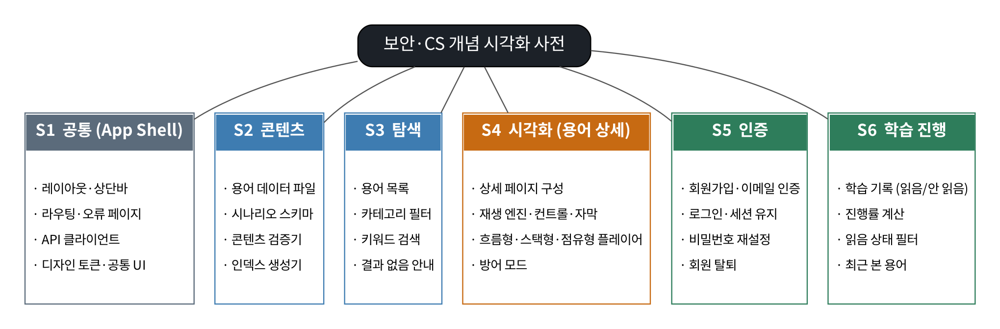
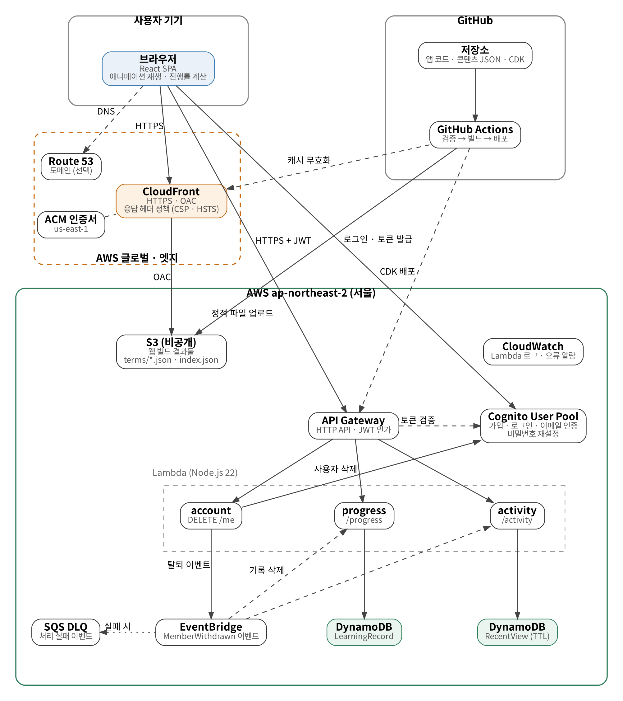

# 아키텍처

서브시스템 구성, 계층 구조, 기술 스택, AWS 배치를 정리한 문서다. 구현 단계는 1.4절과 루트의 `CLAUDE.md`에 같은 내용이 있다.

## 1. 모듈뷰 아키텍처

### 1.1 서브시스템 분해 (Decomposition Style)

요구사항 명세의 서브시스템(SS-01~SS-07)을 출발점으로, 실제로 코드가 나뉘는 단위에 맞게 6개 서브시스템으로 다시 정리했다.

| 서브시스템 | 책임 | 관련 요구사항 |
| --- | --- | --- |
| S1 공통 | 모든 화면이 함께 쓰는 레이아웃, 라우팅, 오류 페이지, API 호출 방식 | FR-EXP-05, FR-DTL-04, FR-AUTH-04 |
| S2 콘텐츠 | 용어 데이터 파일의 형식 정의와 검증, 목록·검색용 인덱스 생성 | SS-06 (FR-CNT-01~05) |
| S3 탐색 | 용어 목록, 카테고리 필터, 키워드 검색 | SS-01 |
| S4 시각화 | 용어 상세 페이지와 애니메이션 플레이어, 재생 제어, 방어 모드 | SS-02, SS-03 |
| S5 인증 | 회원가입, 로그인, 비밀번호 재설정, 회원 탈퇴 | SS-04 |
| S6 학습 진행 | 읽음 기록, 진행률, 읽음 상태 필터, 최근 본 용어 | SS-05 |

요구사항과 달라진 점은 세 가지다. 용어 상세 조회(SS-02)와 애니메이션 재생(SS-03)은 한 화면에서 같은 데이터를 쓰며 함께 동작하므로 S4 하나로 합쳤다. 여러 서브시스템이 함께 쓰는 화면 틀과 API 호출 코드는 S1 공통으로 따로 뺐다. 배포·운영(SS-07)은 코드 모듈이 아니라 실행 환경에 관한 내용이므로 모듈뷰에서 빼고 2장의 할당뷰에서 다룬다.

### 1.2 계층별 상세화 (Frontend / Backend / Database)

각 서브시스템을 Frontend, Backend, Database 계층으로 나누면 다음과 같다.

이 표에서 가장 중요한 특징은 **탐색(S3)과 시각화(S4)에 백엔드가 없다**는 점이다. 용어 콘텐츠는 운영 중에 바뀌지 않고 배포할 때만 바뀌므로, S2가 빌드 시점에 데이터 파일을 검증해 `/content/index.json`(목록·검색용)과 `/content/terms/{id}.json`(용어별 상세·시나리오)으로 만들어 두고, 브라우저는 이 정적 파일만 읽는다. 그래서 학습 기록 API가 멈춰도 용어 조회와 애니메이션 재생은 그대로 동작한다(NFR-02).

백엔드가 필요한 곳은 사용자마다 데이터가 달라지는 S5와 S6뿐이다. 회원가입·로그인·이메일 인증·비밀번호 재설정은 Cognito가 제공하는 기능을 그대로 쓰고, 직접 만드는 API는 회원 탈퇴(Account API)와 학습 기록(Progress API, Activity API)이다. 진행률은 클래스 다이어그램에서 정한 대로 저장하지 않고, 브라우저가 `index.json`의 카테고리별 공개 용어 수와 학습 기록을 합쳐 계산한다.

### 1.3 서브시스템 간 의존 관계

| 사용하는 쪽 | 사용되는 쪽 | 내용 |
| --- | --- | --- |
| S3 탐색, S4 시각화 | S2 콘텐츠 | 빌드된 `/content/index.json`, `/content/terms/{id}.json`을 읽는다 |
| S3 탐색 | S6 학습 진행 | 로그인 시 카드의 읽음 표시, 읽음 필터, 진행률을 보여준다 |
| S4 시각화 | S6 학습 진행 | 마지막 단계까지 재생하면 읽음 기록을 저장한다 |
| S6 학습 진행 | S5 인증 | 로그인 토큰으로 본인 기록만 조회·수정한다 |
| 모든 서브시스템 | S1 공통 | 화면 틀, 라우팅, API 클라이언트 |

S3, S4가 S6을 사용하는 부분은 로그인한 경우에만 동작하는 선택적 의존이다. S6이 없어도 S3, S4는 비회원 기능으로 완전히 동작하므로, 이 의존 방향이 다음 절의 구현 순서를 정하는 근거가 된다.

이전 MSA 과제에서 나눈 서비스와는 다음과 같이 대응된다. User는 S5, Progress와 Activity는 S6의 두 API로 이어진다. Content와 Authoring은 운영 중 서버로 두지 않고 S2의 빌드 파이프라인과 정적 파일로 대신했는데, 용어 콘텐츠는 배포할 때만 바뀌므로 운영 중 서버가 필요 없고, 요구사항의 "데이터 파일로 추가하고 빌드 때 검증"(FR-CNT, DC-03), "상시 서버 없음"(DC-02) 조건에도 맞기 때문이다.

### 1.4 서브시스템별 구현 우선순위

서비스의 핵심 가치는 시각화이므로, 백엔드 없이 동작하는 S2·S4·S3을 먼저 완성하고 인증과 학습 진행을 나중에 붙인다. 각 단계는 끝났을 때 배포된 주소에서 직접 확인할 수 있는 상태를 기준으로 나눴다.

| 단계 | 서브시스템 | 구현 범위 | 완료 기준 |
| --- | --- | --- | --- |
| 1 | S1 공통, S2 콘텐츠 | 프로젝트 생성, 화면 틀, 시나리오 스키마와 검증기, CSRF 데이터 1개, CDK로 S3·CloudFront 최초 배포 | 배포 주소에 빈 화면이 뜨고, 형식이 틀린 데이터는 빌드에서 거부된다 |
| 2 | S4 시각화 (흐름형) | 재생 엔진, 장면 스키마, 3D 흐름형 플레이어, 컨트롤·자막, 방어 모드, 2D 대체 화면 | CSRF가 3D로 끝까지 재생되고, 방어 모드에서 5단계에서 차단된다 |
| 3 | S3 탐색, S2 확장 | 목록, 카테고리 필터, 검색, 보안 용어 4개 데이터 추가 | 플레이어 코드를 고치지 않고 데이터만 추가해 새 용어가 재생된다 |
| 4 | S4 확장 | 3D 스택형·점유형 플레이어, CS 용어 3개 | 초기 용어 8개가 모두 재생된다. 여기까지 비회원 기능 완성 |
| 5 | S5 인증 | Cognito 설정, 회원가입·이메일 인증·로그인·비밀번호 재설정 화면 | 가입부터 로그인까지 되고, 새로고침해도 로그인이 유지된다 |
| 6 | S6 학습 진행, S5 탈퇴 | Progress API, 읽음 기록·진행률·필터, Account API와 탈퇴 시 기록 삭제 | 다른 브라우저에서 로그인해도 같은 진행률이 보이고, 탈퇴 후 기록이 남지 않는다 |
| 7 | 선택 기능 | 최근 본 용어(Activity API), 관련 용어, 재생 속도, 자동 배포 | 요구사항의 "선택" 항목 반영 |

회원 탈퇴는 S5 기능이지만 학습 기록까지 지워야 하므로(FR-AUTH-06), 기록이 생기는 6단계에서 함께 구현한다. 2단계가 가장 중요한데, 여기서 시나리오 형식에 빠진 항목이 드러나면 데이터가 늘어나기 전에 고칠 수 있다.

### 1.5 설계 이름 → 코드 위치

문서(이 문서, `docs/04`, `docs/06`)에 나오는 설계 이름이 코드의 어디에 있는지 정리한다. 코드 검색이나 `graphify query`는 오른쪽의 파일·함수 이름으로 한다. 경로는 `apps/web/src/` 기준이고, `packages/`·`scripts/`는 저장소 루트 기준이다. 코드를 옮기거나 이름을 바꾸면 이 표도 함께 고친다.

**S2 콘텐츠**

| 설계 이름 | 코드 위치 |
| --- | --- |
| 용어 JSON 스키마 (Zod, 단일 정의) | `packages/content-schema/src/index.ts` `termSchema`, `effectSchema`, 타입 `Term`·`Actor`·`Step`·`Defense`·`Effect`·`IndexEntry` |
| 장면 규칙 검사 (참조·부모 순환·뒤집기·아이템 보유) | `packages/content-schema/src/scene.ts` `checkScene()` (`termSchema`의 `superRefine`에서 호출) |
| 행위자 종류(kind)·구역(zone)·아이템 목록 | `packages/content-schema/src/index.ts` `ACTOR_KINDS`, `ZONES`, `ITEMS` |
| 카테고리·플레이어 유형 표시 이름 | `packages/content-schema/src/labels.ts` `CATEGORY_LABELS`, `PLAYER_LABELS`, `ACTIONS_BY_PLAYER` |
| 콘텐츠 검증기 | `scripts/validate-content.ts` `loadTerms()`, `validateOrExit()` |
| 인덱스 생성기 (`index.json`·`terms/<id>.json`, draft 분리) | `scripts/build-index.ts` `selectTerms()`, `toIndexEntry()` |

**S1 공통 · S3 탐색 · S4 상세 화면**

| 설계 이름 | 코드 위치 |
| --- | --- |
| 화면 틀·테마 전환 | `Layout.tsx`, `theme.ts` |
| 정적 JSON 읽기 (JSON이 아닌 응답은 `notfound`로 처리) | `useJson.ts` `useJson()` |
| 용어 목록·검색·카테고리 필터 | `features/explore/HomePage.tsx` `HomePage`, `termMeta()` |
| 용어 상세 페이지 | `features/term/TermPage.tsx` (플레이어는 동적 import) |

**S4 플레이어 (공통)**

| 설계 이름 | 코드 위치 |
| --- | --- |
| PlaybackEngine (단계·재생·방어 모드·끝까지 봄 이벤트) | `players/engine.ts` `reduce()`, `initialState()`, `lastStep()`, 타입 `PlaybackState`·`PlaybackAction` |
| 엔진을 React에 연결 | `players/usePlayback.ts` `usePlayback()` |
| 플레이어 조립 (3D/2D 선택, 동작 줄이기 감지) | `players/Player.tsx` `Player`, `useReducedMotionPref()` |
| 재생 컨트롤·자막·모드 탭·단계 막대·단축키 | `players/PlayerShell.tsx` `PlayerShell` |
| 단계 표시 데이터 (자막·라벨·톤·차단 여부) | `packages/content-schema/src/scene.ts` `stepView()`, `lastStepIndex()` |
| 방어 모드 차단 (`blockedAtStep`) | `scene.ts` `blockingDefenses()`, `lastStepIndex()`, `stepView()`의 `blocked`·`blockedLabel` / `engine.ts` `lastStep()` |
| 무대 공통 입력·단계 유지 시간 | `players/stage.ts` `StageProps`, `HOLD_MS`, `REDUCED_HOLD_MS` |
| 2D 대체 화면 | `players/StepList2D.tsx`, 단계 유지 `players/useHold.ts` `useHold()` |
| WebGL 사용 가능 판정 (`?no3d`로 2D 강제) | `players/webgl.ts` `canUseWebGL()` |

**S4 3D 플레이어 (`docs/06`)**

| 설계 이름 | 코드 위치 |
| --- | --- |
| 3D 흐름형 플레이어 (Canvas, 화면 밖·숨은 탭에서 그리기 멈춤) | `players/three/FlowScene.tsx` `FlowScene` (`IntersectionObserver`·`visibilitychange` → `frameloop`) |
| 단계 재생 (타임라인 취소 → 결과 상태 적용 → 현재 단계 재생) | `players/three/FlowScene.tsx` `SceneRoot` |
| 결과 상태 (이전 단계까지 누적된 장면 상태) | `players/three/sceneState.ts` `sceneStateAt()` |
| 자동 배치 (kind·zone → 좌표) | `players/three/layout.ts` `layoutScene()`, kind·zone 해석은 `scene.ts` `kindOf()`, `zoneOf()` |
| 행위자 모양·장면 물체 (봉투·쿠키·열쇠·도장·카드) | `players/three/model.ts` `SceneModel` |
| 효과 어휘 연출 (appear, flip, rewrite, store, attach, give, run, inspect, transfer) | `players/three/director.ts` `buildStep()` |
| 자동 카메라 (따라가기·근접·전체 샷) | `players/three/director.ts` `CameraRig` |
| `useFrame` 타임라인 (tween·easing) | `players/three/timeline.ts` `Timeline`, `easeInOut`·`easeOut`·`linear` |
| 가림 자동 투명 | `FlowScene.tsx` `SceneRoot`의 `useFrame` (`Raycaster` + `SceneModel.occluders`) |
| 빌보드 (항상 카메라를 향함) | `FlowScene.tsx` `SceneRoot`의 `useFrame` (`SceneModel.billboards`) |
| HTML 라벨 (이름·요청·잔액·검사 목록) | `players/three/labels.ts` `LabelLayer` |
| 색은 디자인 토큰 (런타임에 CSS 변수 읽기, 테마 바뀌면 다시 읽기) | `players/three/tokens.ts` `TOKEN_NAMES`, `readPalette()`, `usePalette()` / 값은 `styles/tokens.css` |
| 화면·도장·카드 그림 | `players/three/textures.ts` `paintScreen()`, `paintStamp()`, `paintCard()` |
| 자유 시점 | `FlowScene.tsx` `OrbitControls` (`freeView`) |
| 스택형·점유형 3D 플레이어 | 4단계에서 추가 예정 (`players/three/StackScene`·`LockScene`, 아직 없음) |

## 2. 기술 스택 정의 및 할당뷰 아키텍처

### 2.1 구현 기술 스택

프론트엔드, 백엔드, 콘텐츠 빌드, 인프라 코드를 모두 TypeScript 하나로 맞춘다. 혼자 개발하므로 언어를 하나로 줄이는 것이 부담이 가장 적고, 시나리오 스키마를 빌드 검증기와 화면 코드가 그대로 공유할 수 있기 때문이다.

| 구분 | 선택 | 선택 이유 |
| --- | --- | --- |
| Frontend 언어·프레임워크 | TypeScript 6, React 19, Vite 8, React Router 8 | 요구사항 제약(DC-01). 데이터 형식 오류를 타입으로 미리 잡을 수 있다 |
| Frontend 애니메이션 | three.js + React Three Fiber(3D 장면), 순수 PlaybackEngine(단계 진행), Framer Motion(일반 UI) | 공간·카메라·물체의 앞뒤로 개념을 보여 주고(docs/06), 단계 진행은 엔진 한 곳이 정해 자막과 장면이 어긋나지 않음 (DC-01) |
| Frontend 인증·데이터 | Amplify Auth 라이브러리, TanStack Query | Cognito 로그인·토큰 갱신을 직접 구현하지 않음. 학습 기록 조회 결과를 캐시해 화면 간 재사용 |
| 콘텐츠 형식·검증 | JSON 데이터 파일, Zod 스키마 | 같은 스키마로 빌드 검증(FR-CNT-02)과 화면 타입을 함께 만든다 |
| Backend 언어·런타임 | TypeScript, Node.js 22 (AWS Lambda) | 호출이 있을 때만 실행되어 상시 서버가 필요 없음 (DC-02) |
| Backend API | Amazon API Gateway (HTTP API), JWT 인가 | Cognito 토큰을 게이트웨이에서 검증하고, Lambda는 토큰의 사용자 ID로만 대상을 정한다 (NFR-01) |
| 서비스 간 이벤트 | Amazon EventBridge, SQS DLQ | 탈퇴 이벤트를 Progress·Activity가 각자 처리. 실패한 이벤트는 DLQ에 남겨 다시 처리 |
| Database | Amazon DynamoDB | 회원의 기록을 회원 ID로만 조회하므로 키-값 구조가 맞고, 사용한 만큼만 과금된다 |
| 인프라 코드·배포 | AWS CDK (TypeScript), GitHub Actions | 1단계부터 S3·CloudFront를 CDK로 만들고 배포한다(`infra/`, `npm run deploy`). 7단계에서 GitHub Actions로 자동화 (FR-DEP-05) |

DynamoDB 테이블은 두 개다. **LearningRecord**는 파티션 키가 회원 ID, 정렬 키가 용어 ID이다. 키 자체가 회원과 용어의 쌍이므로, 클래스 다이어그램의 "회원·용어 쌍마다 학습 기록 하나" 제약이 저장 구조로 지켜지고, 같은 요청이 두 번 와도 같은 항목을 덮어쓸 뿐이다. **RecentView**는 같은 키 구조에 열람 시각을 저장하고, TTL로 일정 기간이 지난 항목을 자동 삭제한다.

### 2.2 운영 환경

모든 구성 요소는 AWS 관리형 서비스이며 상시 운영 서버는 없다(DC-02). 리전은 서울(ap-northeast-2)로 하되, CloudFront에 붙는 ACM 인증서는 AWS 정책상 us-east-1에서 발급한다.

| 대상 | 호스팅 | 주요 설정 |
| --- | --- | --- |
| Frontend (웹 빌드 결과물) | Amazon S3 (비공개) + CloudFront | OAC로 CloudFront만 버킷에 접근, HTTPS 전용, 403·404를 `index.html`(200)로 응답 (FR-DEP-01, 02) |
| 콘텐츠 (용어 JSON) | 같은 S3 버킷 + CloudFront | 빌드 때 생성된 `/content/index.json`, `/content/terms/{id}.json`을 정적 파일로 제공 |
| 보안 헤더 | CloudFront 응답 헤더 정책 | CSP, HSTS, X-Frame-Options, X-Content-Type-Options. CSP는 Cognito와 API 도메인만 연결 허용 (FR-DEP-04) |
| 인증 | Amazon Cognito User Pool | 이메일 인증 코드, 비밀번호 8자 이상·영문과 숫자 포함 정책 (FR-AUTH-02). 기본 이메일 발송은 하루 발송량이 적어 사용자가 늘면 SES 연결 |
| Backend | API Gateway (HTTP API) + Lambda 3개 | account, progress, activity. 모든 경로에 JWT 인가 적용 (FR-DEP-03) |
| Database | Amazon DynamoDB | LearningRecord, RecentView 테이블 |
| 이벤트 | Amazon EventBridge + SQS DLQ | 회원 탈퇴 이벤트 전달과 실패 이벤트 보관 |
| 모니터링 | Amazon CloudWatch | Lambda 로그, 오류율 알람 |
| 배포 | AWS CDK (7단계부터 GitHub Actions에서 실행) | 콘텐츠 검증 → 빌드 → `cdk deploy`가 S3 업로드와 CloudFront 캐시 무효화까지 수행. 백엔드도 같은 CDK 앱으로 배포 |

### 2.3 운영 환경 배치 아키텍처

그림의 요청 흐름은 다섯 가지다.

1. **용어 보기**: 브라우저 → CloudFront → S3. 화면 파일과 용어 JSON을 받아 브라우저에서 애니메이션을 재생한다. 백엔드를 거치지 않는다.
2. **로그인**: 브라우저 → Cognito. 로그인하면 토큰을 받아 이후 API 요청에 붙인다.
3. **학습 기록 저장·조회**: 브라우저 → API Gateway(토큰 검증) → progress Lambda → DynamoDB.
4. **회원 탈퇴**: 브라우저 → API Gateway → account Lambda가 Cognito 사용자를 삭제하고 탈퇴 이벤트를 보낸다. progress·activity Lambda가 이벤트를 받아 각자의 기록을 지운다.
5. **배포**: `npm run deploy`(7단계부터는 GitHub Actions)가 빌드한 뒤 CDK로 배포한다. 웹·콘텐츠는 S3에 올리고 CloudFront 캐시를 비우며, 백엔드도 같은 CDK 앱으로 배포한다.

그림은 7단계까지 끝난 최종 형태다. 4단계까지는 브라우저, CloudFront, S3만으로 동작하고, Cognito와 오른쪽 백엔드 영역은 5단계부터 차례로 추가된다. 인프라는 1단계부터 CDK(`infra/`, 리전 ap-northeast-2)로 관리한다.
